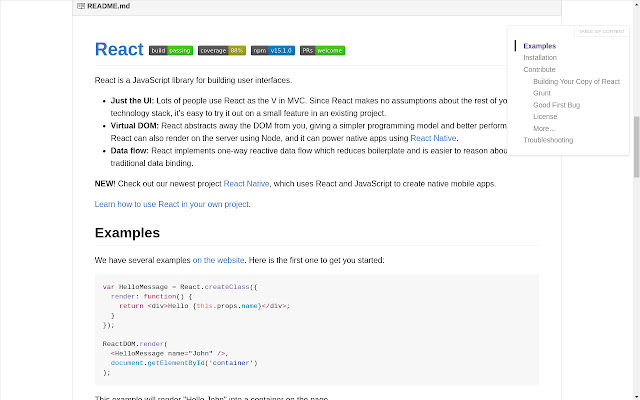

[简体中文](README.md) · [English](README-en.md)

# Study Is Wonderful

**A multidisciplinary collection of open courses and technical blogs**

> Discover great courses and technical articles across disciplines. Whether you are building foundations or exploring something new, come learn, share, and grow with us!

> This project is maintained again. [Issues](https://github.com/xioacd99/study-is-wonderful/issues) and [pull requests](https://github.com/xioacd99/study-is-wonderful/pulls) are welcome for recommendations, corrections, and improvements.

> For easier navigation through this long list, try the Chrome extension [Smart TOC](https://chrome.google.com/webstore/detail/smart-toc/lifgeihcfpkmmlfjbailfpfhbahhibba?utm_source=chrome-ntp-icon), which adds a navigable table of contents to the side of the page.

## Resource map

[Open the interactive course map](https://xioacd99.github.io/study-is-wonderful/resource-map/) · [Source and maintenance guide](resource-map/README.md)

Expand a subject, select a course to jump to its description, or open its original source. Use ↩ beside any course to return here.

<strong>Math</strong> · 26 courses

- [MIT 18.065·Matrix Methods in Data Analysis, Signal Processing, and Machine Learning (Spring 2018)](#course-math-01) · [Open course](https://ocw.mit.edu/courses/18-065-matrix-methods-in-data-analysis-signal-processing-and-machine-learning-spring-2018/)
- [Mathematical Thinking](#course-math-02) · [Open course](https://www.bilibili.com/BV1dq4y127TF)
- [Convex Optimization](#course-math-03) · [Open course](https://www.bilibili.com/BV1Pg4y187Ed)
- [The Fourier Transform and Its Applications](#course-math-04) · [Open course](https://www.bilibili.com/BV1Qx411J7ER)
- [Matrix Theory and Applications](#course-math-05) · [Open course](https://www.bilibili.com/BV17h411W7bk)
- [Convex Optimization](#course-math-06) · [Open course](https://www.bilibili.com/BV12x411z7ot)
- [Advanced Optimization and Stochastic Methods](#course-math-07) · [Open course](https://www.bilibili.com/BV1J64y1F7nW)
- [Discrete Differential Geometry](#course-math-08) · [Open course](https://www.bilibili.com/BV1RQ4y1Z7HL)
- [Optimization Methods](#course-math-09) · [Open course](https://www.bilibili.com/BV19y4y1W7X1)
- [Numerical Analysis](#course-math-10) · [Open course](https://www.bilibili.com/BV1gv411j7rd)
- [Stochastic Processes](#course-math-11) · [Open course](https://www.bilibili.com/BV1qB4y1A7t3)
- [Numerical Methods](#course-math-12) · [Open course](https://www.bilibili.com/BV1sT4y1S7Aa)
- [Probability](#course-math-13) · [Open course](https://www.bilibili.com/BV1kE41157pa)
- [Abstract Algebra](#course-math-14) · [Open course](https://www.bilibili.com/BV1Ds41167HE)
- [Probability](#course-math-15) · [Open course](https://www.bilibili.com/BV19s41167TE)
- [Applied Statistics](#course-math-16) · [Open course](https://www.bilibili.com/BV14t411N7uw)
- [Discrete Stochastic Processes](#course-math-17) · [Open course](https://www.bilibili.com/BV1Qs41167VS)
- [Fourier Analysis](#course-math-18) · [Open course](https://www.bilibili.com/BV1Qz4y167rb)
- [Linear Algebra](#course-math-19) · [Open course](https://www.bilibili.com/BV1zx411g7gq)
- [Linear Algebra](#course-math-20) · [Open course](https://www.bilibili.com/BV1fi4y1x7AH)
- [Discrete Mathematics](#course-math-21) · [Open course](https://www.bilibili.com/BV1zh41167Uy)
- [Complex Analysis](#course-math-22) · [Open course](https://www.bilibili.com/BV1EJ41147q3)
- [Differential Equations](#course-math-23) · [Open course](https://www.bilibili.com/BV1eM4y1g7De)
- [Graph Theory and Additive Combinatorics](#course-math-24) · [Open course](https://www.bilibili.com/BV1Ei4y1x73V)
- [Riemannian Geometry](#course-math-25) · [Open course](https://www.bilibili.com/BV19T4y1M7W5)
- [Game Theory](#course-math-26) · [Open course](https://www.bilibili.com/BV1Kt411h7Ep)

<strong>Computer Science</strong> · 57 courses

- [MIT 6.172·Performance Engineering of Software Systems (Fall 2018)](#course-cs-01) · [Open course](https://ocw.mit.edu/courses/6-172-performance-engineering-of-software-systems-fall-2018/)
- [MIT·The Missing Semester of Your CS Education (2026)](#course-cs-02) · [Open course](https://www.youtube.com/playlist?list=PLyzOVJj3bHQunmnnTXrNbZnBaCA-ieK4L)
- [Great Ideas in Theoretical Computer Science](#course-cs-03) · [Open course](https://www.bilibili.com/BV1Wh411y7V9)
- [The Missing Semester of Your CS Education](#course-cs-04) · [Open course](https://www.bilibili.com/BV1x7411H7wa)
- [CS50X Introduction to Computer Science](#course-cs-05) · [Open course](https://www.bilibili.com/BV1ER4y157uA)
- [Programming Methodology](#course-cs-06) · [Open course](https://www.bilibili.com/BV1zs411h7t8)
- [CS101](#course-cs-07) · [Open course](https://web.stanford.edu/class/cs101/)
- [Introduction to Computer Science and Programming in Python](#course-cs-08) · [Open course](https://ocw.mit.edu/courses/electrical-engineering-and-computer-science/6-0001-introduction-to-computer-science-and-programming-in-python-fall-2016/)
- [Classical Algorithms](#course-cs-09) · [Open course](https://www.bilibili.com/BV1kf4y1w7Kn)
- [Introduction to Algorithms](#course-cs-10) · [Open course](https://www.bilibili.com/BV1fu41127MN)
- [Advanced Data Structures](#course-cs-11) · [Open course](https://www.bilibili.com/BV1iE411n7yJ)
- [Advanced Algorithms](#course-cs-12) · [Open course](https://www.bilibili.com/BV11E411u73m)
- [Data Structures and Algorithm Design](#course-cs-13) · [Open course](https://www.bilibili.com/BV1sf4y1H7vb)
- [CS 61B](#course-cs-14) · [Open course](https://inst.eecs.berkeley.edu/~cs61b/sp20/index.html)
- [CS106B Programming Abstractions](#course-cs-15) · [Open course](https://web.stanford.edu/class/cs106b/)
- [CSE 373 "The Algorithm Design Manual"](#course-cs-16) · [Open course](https://www3.cs.stonybrook.edu/~skiena/373/videos/)
- [Introduction to Computer Systems](#course-cs-17) · [Open course](https://www.bilibili.com/BV1uK4y1e7ep)
- [Operating System and Systems Programming](#course-cs-18) · [Open course](https://www.bilibili.com/BV1ix411676b)
- [Operating Systems](#course-cs-19) · [Open course](https://www.bilibili.com/BV1QA411F7ij)
- [Distributed Systems](#course-cs-20) · [Open course](https://www.bilibili.com/BV1CU4y1P7PE)
- [Computer Systems Security](#course-cs-21) · [Open course](https://www.bilibili.com/BV1jt411F7Wh)
- [CS 61C](#course-cs-22) · [Open course](https://inst.eecs.berkeley.edu/~cs61c/fa20/)
- [15-213](#course-cs-23) · [Open course](https://www.bilibili.com/video/BV1iW411d7hd)
- [CS 107](#course-cs-24) · [Open course](http://web.stanford.edu/class/cs107/)
- [Operating Systems](#course-cs-25) · [Open course](https://space.bilibili.com/202224425/channel/collectiondetail?sid=192498)
- [CMU·Applied Data Science](#course-cs-26) · [Open course](https://www.bilibili.com/BV1Pa411F7VP)
- [UC Berkeley·Principles and Techniques of Data Science](#course-cs-27) · [Open course](https://www.bilibili.com/BV19741117jR)
- [Caltech·Data-Driven Algorithm Design](#course-cs-28) · [Open course](https://www.bilibili.com/BV1ip4y1X7uY)
- [Stanford·Introduction to Big Data](#course-cs-29) · [Open course](https://www.bilibili.com/BV1SC4y187x1)
- [Harvard·Big Data Algorithms](#course-cs-30) · [Open course](https://www.bilibili.com/BV1v54y1x7dQ)
- [Stanford·CS 246](#course-cs-31) · [Open course](http://web.stanford.edu/class/cs246/)
- [CMU·Introduction to Database Systems](#course-cs-32) · [Open course](https://www.bilibili.com/BV1Cp4y1C7dv)
- [CMU·Database Systems](#course-cs-33) · [Open course](https://www.bilibili.com/BV1rN411f7Ef)
- [UC Berkeley·Introduction to Databases](#course-cs-34) · [Open course](https://www.bilibili.com/BV1yb4y1n7rb)
- [CMU·Parallel Computer Architecture and Programming](#course-cs-35) · [Open course](https://www.bilibili.com/BV16k4y1z7z9)
- [UC Berkeley·Applications of Parallel Computing](#course-cs-36) · [Open course](https://www.bilibili.com/BV1qV411q7RS)
- [UC Berkeley·Introduction to Parallel Programming](#course-cs-37) · [Open course](https://www.bilibili.com/BV1QQ4y1o7rn)
- [Cornell·Software Engineering](#course-cs-38) · [Open course](https://www.bilibili.com/BV1aW411E7yr)
- [CMU·Software Engineering for Intelligent Systems](#course-cs-39) · [Open course](https://www.bilibili.com/BV1qA411n7X5)
- [Stanford·Compilers](#course-cs-40) · [Open course](https://www.bilibili.com/BV1NW41177q4)
- [Cornell·Advanced Compilers](#course-cs-41) · [Open course](https://www.bilibili.com/BV1hZ4y1L7X4)
- [CMU·Computer Networks](#course-cs-42) · [Open course](https://www.bilibili.com/BV1wT4y1A7cd)
- [Stanford·Computer Networks](#course-cs-43) · [Open course](https://www.bilibili.com/BV137411Z7LR)
- [Stanford·Network Security](#course-cs-44) · [Open course](https://www.bilibili.com/BV1yA411s7Tp)
- [CMU·Computer Graphics](#course-cs-45) · [Open course](https://www.bilibili.com/BV1QZ4y1K7ga)
- [Lingqi Yan·Introduction to Modern Computer Graphics](#course-cs-46) · [Open course](https://www.bilibili.com/BV1X7411F744)
- [MIT·Computer Graphics](#course-cs-47) · [Open course](https://www.bilibili.com/BV167411g7iK)
- [CMU·Human-Computer Interaction Lecture Series](#course-cs-48) · [Open course](https://www.bilibili.com/BV1Bb411v7YH)
- [Princeton·Bitcoin and Cryptocurrency Technologies](#course-cs-49) · [Open course](https://www.bilibili.com/BV1FL411K7vK)
- [Stanford·Cryptography](#course-cs-50) · [Open course](https://www.bilibili.com/BV1Ht411w7Re)
- [Stanford·Programming Abstractions in C++](#course-cs-51) · [Open course](https://www.bilibili.com/BV1G7411k7jG)
- [MIT·Structure and Interpretation of Computer Programs](#course-cs-52) · [Open course](https://www.bilibili.com/BV1AA411t7Wk)
- [MIT·Signals and Systems](#course-cs-53) · [Open course](https://www.bilibili.com/BV1L4411H7w3)
- [Oppenheim·MIT·Signals and Systems](#course-cs-54) · [Open course](https://www.bilibili.com/BV1CZ4y1j7hs)
- [MIT·Computation Structures](#course-cs-55) · [Open course](https://www.bilibili.com/BV197411s736)
- [MIT·Python Programming](#course-cs-56) · [Open course](https://www.bilibili.com/BV1mq4y1u7NB)
- [MIT·Blockchain and Money](#course-cs-57) · [Open course](https://www.bilibili.com/BV1pK4y1r7Jf)

<strong>Artificial Intelligence</strong> · 36 courses

- [Stanford CS224R·Deep Reinforcement Learning](#course-ai-01) · [Open course](https://www.bilibili.com/video/BV1U2zYBqEFB/)
- [Stanford CS224R·Deep Reinforcement Learning (Spring 2025)](#course-ai-02) · [Open course](https://www.bilibili.com/video/BV15E2SB7EzE/)
- [ETH Zurich·Robot Learning: From Fundamentals to Foundation Models (2026)](#course-ai-03) · [Open course](https://cvg.ethz.ch/lectures/Robot-Learning/)
- [Stanford CS336: Language Modeling from Scratch (Lecture 1)](#course-ai-04) · [Open course](https://www.youtube.com/watch?v=SQ3fZ1sAqXI)
- [Zhejiang University: Principles and Techniques of Large Models](#course-ai-05) · [Open course](https://www.bilibili.com/video/BV1PB6XYFET2/)
- [CMU·Artificial Intelligence (Graduate)](#course-ai-06) · [Open course](https://www.bilibili.com/BV1pC4y1t7px)
- [Hung-yi Lee·Deep Learning Theory](#course-ai-07) · [Open course](https://www.youtube.com/watch?v=KKT2VkTdFyc&list=RDLVKKT2VkTdFyc&start_radio=1&rv=KKT2VkTdFyc&t=5)
- [Hung-yi Lee·Next Step of Machine Learning](#course-ai-08) · [Open course](https://www.youtube.com/watch?v=XnyM3-xtxHs&list=PLJV_el3uVTsOK_ZK5L0Iv_EQoL1JefRL4)
- [Hung-yi Lee·Advanced Topics in Deep Learning](#course-ai-09) · [Open course](https://www.youtube.com/watch?v=IzHoNwlCGnE&list=PLJV_el3uVTsPMxPbjeX7PicgWbY7F8wW9)
- [Hung-yi Lee·Machine Learning-v1](#course-ai-10) · [Open course](https://www.youtube.com/watch?v=CXgbekl66jc&list=PLJV_el3uVTsPy9oCRY30oBPNLCo89yu49)
- [Hung-yi Lee·Machine Learning-v2](#course-ai-11) · [Open course](https://www.youtube.com/watch?v=Ye018rCVvOo&list=PLJV_el3uVTsMhtt7_Y6sgTHGHp1Vb2P2J)
- [Hung-yi Lee·Machine Learning-v1](#course-ai-12) · [Open course](https://www.youtube.com/watch?v=7XZR0-4uS5s&list=PLJV_el3uVTsPM2mM-OQzJXziCGJa8nJL8)
- [Hung-yi Lee·Machine Learning: TA Supplement](#course-ai-13) · [Open course](https://www.youtube.com/watch?v=eybCCtNKwzA&list=PLJV_el3uVTsM8QoIIe9JrSDjB0e1UkbEC)
- [MIT·Deep Learning](#course-ai-14) · [Open course](https://www.bilibili.com/BV1qt411c7Na)
- [MIT·Machine Learning](#course-ai-15) · [Open course](https://www.bilibili.com/BV1a7411M7wH)
- [Stanford·Principles and Techniques of Artificial Intelligence](#course-ai-16) · [Open course](https://www.bilibili.com/BV1Ht4y1U75j)
- [Berkeley·CS 188](#course-ai-17) · [Open course](https://inst.eecs.berkeley.edu//~cs188/fa19/)
- [Berkeley·CS 189](#course-ai-18) · [Open course](https://www.eecs189.org/)
- [Hung-yi Lee·GAN-2018](#course-ai-19) · [Open course](https://www.youtube.com/watch?v=DQNNMiAP5lw&list=PLJV_el3uVTsMq6JEFPW35BCiOQTsoqwNw)
- [Hung-yi Lee·GAN-2017](#course-ai-20) · [Open course](https://www.youtube.com/watch?v=G0dZc-8yIjE&list=PLJV_el3uVTsMd2G9ZjcpJn1YfnM9wVOBf)
- [CMU·Natural Language Processing](#course-ai-21) · [Open course](https://www.bilibili.com/BV1dC4y1h788)
- [Stanford·Deep Natural Language Processing](#course-ai-22) · [Open course](https://www.bilibili.com/BV1pt411h7aT)
- [CMU·Advanced Natural Language Processing](#course-ai-23) · [Open course](https://www.bilibili.com/BV1H3411k7GA)
- [Hung-yi Lee·Deep Learning for Human Languange Processing](#course-ai-24) · [Open course](https://www.youtube.com/watch?v=nER51ZyJaCQ&list=PLJV_el3uVTsO07RpBYFsXg-bN5Lu0nhdG)
- [Hung-yi Lee·Deep Reinforcement Learning](#course-ai-25) · [Open course](https://www.youtube.com/watch?v=z95ZYgPgXOY&list=PLJV_el3uVTsODxQFgzMzPLa16h6B8kWM_)
- [Stanford·Reinforcement Learning](#course-ai-26) · [Open course](https://www.bilibili.com/BV1sb411s7eQ)
- [MIT·Identification, Estimation, and Learning](#course-ai-27) · [Open course](https://www.bilibili.com/BV1KL4y1e7F7)
- [UC Berkeley·Deep Reinforcement Learning](#course-ai-28) · [Open course](https://www.bilibili.com/BV1fx411S7S8)
- [UC Berkeley·Statistical Machine Learning](#course-ai-29) · [Open course](https://www.bilibili.com/BV1KA41157yn)
- [Stanford·Statistical Learning](#course-ai-30) · [Open course](https://www.bilibili.com/BV1NW41177q4)
- [CMU·Machine Learning for Structured Data](#course-ai-31) · [Open course](https://www.bilibili.com/BV1MK4y1a7PS)
- [Caltech·Foundations of Machine Learning and Statistical Inference](#course-ai-32) · [Open course](https://www.bilibili.com/BV1uA411n7oV)
- [Hung-yi Lee·Structured Learning](#course-ai-33) · [Open course](https://www.youtube.com/watch?v=5OYu0vxXEv8&list=PLJV_el3uVTsNHQKxv49vpq7NSn-zim18V)
- [Stanford·Machine Learning with Graphs](#course-ai-34) · [Open course](https://www.bilibili.com/BV1Vg4y1z7Nf)
- [Stanford·Robotics](#course-ai-35) · [Open course](https://www.bilibili.com/BV16s411q7o7)
- [MIT·Machine Learning for Healthcare](#course-ai-36) · [Open course](https://www.bilibili.com/BV1oa411c7eD)

<strong>Economics</strong> · 4 courses

- [Financial Markets](#course-economics-01) · [Open course](https://www.bilibili.com/BV1ab411b7jq)
- [Microeconomics](#course-economics-02) · [Open course](https://www.bilibili.com/BV1MV411U75D)
- [Financial Theory](#course-economics-03) · [Open course](https://www.bilibili.com/BV1Ft4112796)
- [Behavioral Economics](#course-economics-04) · [Open course](https://www.bilibili.com/BV11U4y1g78u)

<strong>Physics</strong> · 5 courses

- [Yale ASTR 160·Frontiers and Controversies in Astrophysics (Spring 2007)](#course-physics-01) · [Open course](https://oyc.yale.edu/astronomy/astr-160)
- [MIT 8.01SC·Classical Mechanics (Fall 2016)](#course-physics-02) · [Open course](https://ocw.mit.edu/courses/8-01sc-classical-mechanics-fall-2016/)
- [Quantum Mechanics](#course-physics-03) · [Open course](https://www.bilibili.com/BV1w4411s7da)
- [General Relativity](#course-physics-04) · [Open course](https://www.bilibili.com/BV1tE411R75K)
- [String Theory and M Theory](#course-physics-05) · [Open course](https://www.bilibili.com/BV1CE411Q7Cc)

<strong>Psychology</strong> · 6 courses

- [Psychological Statistics](#course-psychology-01) · [Open course](https://www.bilibili.com/BV1UJ411c7d8)
- [Social and Cognitive Psychology](#course-psychology-02) · [Open course](https://www.bilibili.com/BV1Hx411u7SK)
- [Introduction to Psychology](#course-psychology-03) · [Open course](https://www.bilibili.com/BV1Ps411Z7h1)
- [Positive Psychology](#course-psychology-04) · [Open course](https://www.bilibili.com/BV1ga41127Zt)
- [Introduction to Psychology](#course-psychology-05) · [Open course](https://www.bilibili.com/BV1hZ4y1w7kd)
- [Happiness Course](#course-psychology-06) · [Open course](https://www.bilibili.com/BV1px411d7xr)

<strong>Social Sciences</strong> · 4 courses

- [Yale HIST 119·The Civil War and Reconstruction Era, 1845–1877 (Spring 2008)](#course-social-01) · [Open course](https://oyc.yale.edu/history/hist-119)
- [Foundations of Modern Social Theory](#course-social-02) · [Open course](https://www.bilibili.com/BV1ux411r736)
- [Capitalism](#course-social-03) · [Open course](https://www.bilibili.com/BV1x5411g7R5)
- [Introduction to Political Philosophy](#course-social-04) · [Open course](https://www.bilibili.com/BV1wx411y7uW)

<strong>Biology</strong> · 1 courses

- [Human Behavioral Biology](#course-biology-01) · [Open course](https://www.bilibili.com/BV1FF411Y72Y)

<strong>Philosophy and Arts</strong> · 2 courses

- [Yale ENGL 310·Modern Poetry (Spring 2007)](#course-arts-01) · [Open course](https://oyc.yale.edu/english/engl-310)
- [Aesthetics](#course-arts-02) · [Open course](https://www.bilibili.com/BV1av411e778)

<strong>Others</strong> · 9 courses

- [Geometric Folding Algorithms](#course-other-01) · [Open course](https://www.bilibili.com/BV14q4y1R7Ra)
- [How to Start a Startup](#course-other-02) · [Open course](https://www.bilibili.com/BV1KK4y1s7mY)
- [Scientific Paper Writing](#course-other-03) · [Open course](https://www.bilibili.com/BV1zv41177JQ)
- [Ou Lijuan on Dream of the Red Chamber](#course-other-04) · [Open course](https://www.bilibili.com/BV1hp4y1t7zq)
- [Luo Xiang on Criminal Law](#course-other-05) · [Open course](https://www.bilibili.com/BV1dj411f7vb)
- [Listening to Music](#course-other-06) · [Open course](https://www.bilibili.com/BV1sW411a7nM)
- [Introduction to Literary Theory](#course-other-07) · [Open course](https://www.bilibili.com/BV15s411x7LU)
- [Managing Emotions](#course-other-08) · [Open course](https://www.bilibili.com/BV1KK4y1P7Df)
- [Introduction to Negotiation](#course-other-09) · [Open course](https://www.bilibili.com/BV13T4y1L7AT)

<strong>Technical blogs</strong>

- [Agents and AI coding](#智能体与-ai-编程-agents-and-ai-coding)
- [AI evaluation](#ai-评测-ai-evaluation)
- [Engineering infrastructure](#工程基础设施-engineering-infrastructure)
- [Science and engineering applications](#科研与工程应用-science-and-engineering-applications)

## Contents

- [Math](#数学-math)
- [Computer Science](#计算机科学-computer-science)
- [Artificial Intelligence](#人工智能-artificial-intelligence)
- [Economics](#经济学-economics)
- [Physics](#物理学-physics)
- [Psychology](#心理学-psychology)
- [Social Sciences](#社会科学-social-sciences)
- [Biology](#生物学-biology)
- [Philosophy and Arts](#哲学与艺术-philosophy-and-arts)
- [Others](#其他-others)
- [Technical blogs](#技术博客-technical-blogs)

## Math

Within each topic, courses roughly progress from foundations to advanced methods, not a strict prerequisite chain or difficulty rating. Different course versions are not assumed equivalent.

### Algebra and matrix methods

| Course | Description | Sources |
| --- | --- | --- |
| [Linear Algebra](https://www.bilibili.com/BV1zx411g7gq) [↩ Back to map](#resource-map) | Use vectors and matrices to solve linear equations and understand directions in space. | [Course](https://www.bilibili.com/BV1zx411g7gq) |
| [Linear Algebra](https://www.bilibili.com/BV1fi4y1x7AH) [↩ Back to map](#resource-map) | Explore how vectors, matrices and linear transformations describe data and space. | [Course](https://www.bilibili.com/BV1fi4y1x7AH) |
| [Matrix Theory and Applications](https://www.bilibili.com/BV17h411W7bk) [↩ Back to map](#resource-map) | Use vectors and matrices to organize data and equations and explore their applications. | [Course](https://www.bilibili.com/BV17h411W7bk) |
| [MIT 18.065·Matrix Methods in Data Analysis, Signal Processing, and Machine Learning (Spring 2018)](https://ocw.mit.edu/courses/18-065-matrix-methods-in-data-analysis-signal-processing-and-machine-learning-spring-2018/) [↩ Back to map](#resource-map) | Learn matrix factorizations, probability, statistics, and optimization with Gilbert Strang, and see how linear algebra supports data analysis and deep learning. | [Course](https://ocw.mit.edu/courses/18-065-matrix-methods-in-data-analysis-signal-processing-and-machine-learning-spring-2018/)（MIT OpenCourseWare） · [Official Lecture 1](https://www.youtube.com/watch?v=YiqIkSHSmyc)（YouTube） |
| [Abstract Algebra](https://www.bilibili.com/BV1Ds41167HE) [↩ Back to map](#resource-map) | Study abstract structures such as groups and rings and the rules of their operations. | [Course](https://www.bilibili.com/BV1Ds41167HE) |

### Mathematical thinking and games

| Course | Description | Sources |
| --- | --- | --- |
| [Mathematical Thinking](https://www.bilibili.com/BV1dq4y127TF) [↩ Back to map](#resource-map) | Practice asking questions, reasoning and explaining why an answer is true with a proof. | [Course](https://www.bilibili.com/BV1dq4y127TF) |
| [Game Theory](https://www.bilibili.com/BV1Kt411h7Ep) [↩ Back to map](#resource-map) | Study strategies when each person’s choices affect others. | [Course](https://www.bilibili.com/BV1Kt411h7Ep) |

### Optimization and numerical computing

| Course | Description | Sources |
| --- | --- | --- |
| [Optimization Methods](https://www.bilibili.com/BV19y4y1W7X1) [↩ Back to map](#resource-map) | Explore how to find the best feasible solution among possible choices. | [Course](https://www.bilibili.com/BV19y4y1W7X1) |
| [Convex Optimization](https://www.bilibili.com/BV1Pg4y187Ed) [↩ Back to map](#resource-map) | Explore how convexity can help find an optimal solution, like finding the bottom of a bowl. | [Course](https://www.bilibili.com/BV1Pg4y187Ed) |
| [Convex Optimization](https://www.bilibili.com/BV12x411z7ot) [↩ Back to map](#resource-map) | Learn how convex optimization finds the best result among constrained choices. | [Course](https://www.bilibili.com/BV12x411z7ot) |
| [Numerical Analysis](https://www.bilibili.com/BV1gv411j7rd) [↩ Back to map](#resource-map) | Study how computers find approximate answers and how to analyze error. | [Course](https://www.bilibili.com/BV1gv411j7rd) |
| [Numerical Methods](https://www.bilibili.com/BV1sT4y1S7Aa) [↩ Back to map](#resource-map) | Learn numerical ways to approximate solutions to hard mathematical problems. | [Course](https://www.bilibili.com/BV1sT4y1S7Aa) |
| [Advanced Optimization and Stochastic Methods](https://www.bilibili.com/BV1J64y1F7nW) [↩ Back to map](#resource-map) | Explore optimization methods and how to handle randomness. | [Course](https://www.bilibili.com/BV1J64y1F7nW) |

### Analysis and differential equations

| Course | Description | Sources |
| --- | --- | --- |
| [The Fourier Transform and Its Applications](https://www.bilibili.com/BV1Qx411J7ER) [↩ Back to map](#resource-map) | See how the Fourier transform breaks a complex signal into frequencies. | [Course](https://www.bilibili.com/BV1Qx411J7ER) |
| [Fourier Analysis](https://www.bilibili.com/BV1Qz4y167rb) [↩ Back to map](#resource-map) | Study functions and signals through frequencies, like breaking sound into tones. | [Course](https://www.bilibili.com/BV1Qz4y167rb) |
| [Complex Analysis](https://www.bilibili.com/BV1EJ41147q3) [↩ Back to map](#resource-map) | Explore complex numbers and functions and how they help solve mathematical problems. | [Course](https://www.bilibili.com/BV1EJ41147q3) |
| [Differential Equations](https://www.bilibili.com/BV1eM4y1g7De) [↩ Back to map](#resource-map) | Use equations to describe change, such as how an object’s position changes over time. | [Course](https://www.bilibili.com/BV1eM4y1g7De) |

### Geometry and discrete mathematics

| Course | Description | Sources |
| --- | --- | --- |
| [Discrete Mathematics](https://www.bilibili.com/BV1zh41167Uy) [↩ Back to map](#resource-map) | Study discrete objects such as logical statements, sets and graphs of points and links. | [Course](https://www.bilibili.com/BV1zh41167Uy) |
| [Graph Theory and Additive Combinatorics](https://www.bilibili.com/BV1Ei4y1x73V) [↩ Back to map](#resource-map) | Study graphs of points and links and patterns formed by adding sets of numbers. | [Course](https://www.bilibili.com/BV1Ei4y1x73V) |
| [Discrete Differential Geometry](https://www.bilibili.com/BV1RQ4y1Z7HL) [↩ Back to map](#resource-map) | Study curves, surfaces and geometric shapes using discrete points and meshes. | [Course](https://www.bilibili.com/BV1RQ4y1Z7HL) |
| [Riemannian Geometry](https://www.bilibili.com/BV19T4y1M7W5) [↩ Back to map](#resource-map) | Study distance and curvature in curved spaces, such as the surface of Earth. | [Course](https://www.bilibili.com/BV19T4y1M7W5) |

### Probability, statistics and stochastic processes

| Course | Description | Sources |
| --- | --- | --- |
| [Probability](https://www.bilibili.com/BV1kE41157pa) [↩ Back to map](#resource-map) | Use probability to describe uncertainty, such as how likely an event is. | [Course](https://www.bilibili.com/BV1kE41157pa) |
| [Probability](https://www.bilibili.com/BV19s41167TE) [↩ Back to map](#resource-map) | Learn to describe uncertain outcomes using probability and random variables. | [Course](https://www.bilibili.com/BV19s41167TE) |
| [Applied Statistics](https://www.bilibili.com/BV14t411N7uw) [↩ Back to map](#resource-map) | Learn to estimate, compare and make informed judgments from data. | [Course](https://www.bilibili.com/BV14t411N7uw) |
| [Stochastic Processes](https://www.bilibili.com/BV1qB4y1A7t3) [↩ Back to map](#resource-map) | Study processes that change over time with uncertain outcomes. | [Course](https://www.bilibili.com/BV1qB4y1A7t3) |
| [Discrete Stochastic Processes](https://www.bilibili.com/BV1Qs41167VS) [↩ Back to map](#resource-map) | Study how random events evolve across times or states. | [Course](https://www.bilibili.com/BV1Qs41167VS) |

## Computer Science

### Parallelism, distributed systems and performance

| Course | Description | Sources |
| --- | --- | --- |
| [CMU·Parallel Computer Architecture and Programming](https://www.bilibili.com/BV16k4y1z7z9) [↩ Back to map](#resource-map) | Explore how multiple processors work together and how to program them. | [Course](https://www.bilibili.com/BV16k4y1z7z9) |
| [UC Berkeley·Introduction to Parallel Programming](https://www.bilibili.com/BV1QQ4y1o7rn) [↩ Back to map](#resource-map) | Explore programming ideas for dividing work among processors that run together. | [Course](https://www.bilibili.com/BV1QQ4y1o7rn) |
| [UC Berkeley·Applications of Parallel Computing](https://www.bilibili.com/BV1qV411q7RS) [↩ Back to map](#resource-map) | Explore how parallel computing can help solve computational problems faster. | [Course](https://www.bilibili.com/BV1qV411q7RS) |
| [MIT 6.172·Performance Engineering of Software Systems (Fall 2018)](https://ocw.mit.edu/courses/6-172-performance-engineering-of-software-systems-fall-2018/) [↩ Back to map](#resource-map) | Learn to analyze program performance through examples such as matrix multiplication, and understand how algorithms, programming languages, and computer systems affect execution speed. | [Course](https://ocw.mit.edu/courses/6-172-performance-engineering-of-software-systems-fall-2018/)（MIT OpenCourseWare） · [Official Lecture 1](https://www.youtube.com/watch?v=o7h_sYMk_oc)（YouTube） · [Repost](https://www.bilibili.com/video/BV1wA411h7N7/)（Bilibili） |
| [Distributed Systems](https://www.bilibili.com/BV1CU4y1P7PE) [↩ Back to map](#resource-map) | Explore distributed systems and how multiple computers work together on tasks. | [Course](https://www.bilibili.com/BV1CU4y1P7PE) |

### Programming foundations and developer tools

| Course | Description | Sources |
| --- | --- | --- |
| [CS50X Introduction to Computer Science](https://www.bilibili.com/BV1ER4y157uA) [↩ Back to map](#resource-map) | Start learning computer science and programming by breaking problems into steps a computer can follow. | [Course](https://www.bilibili.com/BV1ER4y157uA) |
| [CS101](https://web.stanford.edu/class/cs101/) [↩ Back to map](#resource-map) | Meet computer hardware, software, and data, along with programming ideas such as variables and loops. | [Course](https://web.stanford.edu/class/cs101/) |
| [Introduction to Computer Science and Programming in Python](https://ocw.mit.edu/courses/electrical-engineering-and-computer-science/6-0001-introduction-to-computer-science-and-programming-in-python-fall-2016/) [↩ Back to map](#resource-map) | Learn programming basics in Python and practice solving problems with small programs. | [Course](https://ocw.mit.edu/courses/electrical-engineering-and-computer-science/6-0001-introduction-to-computer-science-and-programming-in-python-fall-2016/) |
| [Programming Methodology](https://www.bilibili.com/BV1zs411h7t8) [↩ Back to map](#resource-map) | Learn programming methods and practice breaking big problems into manageable steps. | [Course](https://www.bilibili.com/BV1zs411h7t8) |
| [MIT·Python Programming](https://www.bilibili.com/BV1mq4y1u7NB) [↩ Back to map](#resource-map) | Explore how to express ideas and write programs in Python. | [Course](https://www.bilibili.com/BV1mq4y1u7NB) |
| [The Missing Semester of Your CS Education](https://www.bilibili.com/BV1x7411H7wa) [↩ Back to map](#resource-map) | Meet tools programmers use, such as the command line, debuggers, and version control. | [Course](https://www.bilibili.com/BV1x7411H7wa) |
| [MIT·The Missing Semester of Your CS Education (2026)](https://www.youtube.com/playlist?list=PLyzOVJj3bHQunmnnTXrNbZnBaCA-ieK4L) [↩ Back to map](#resource-map) | Learn shell tools, development workflows, debugging, Git, software delivery, and code quality, including how agentic coding fits into everyday development. | [Course](https://www.youtube.com/playlist?list=PLyzOVJj3bHQunmnnTXrNbZnBaCA-ieK4L) · [Chinese-dubbed repost](https://www.bilibili.com/video/BV1JgACzjEo8/)  · [Course website](https://missing.csail.mit.edu/2026/) |
| [CS106B Programming Abstractions](https://web.stanford.edu/class/cs106b/) [↩ Back to map](#resource-map) | Use programming abstractions to manage complexity and learn tools such as recursion and data structures. | [Course](https://web.stanford.edu/class/cs106b/) |
| [Stanford·Programming Abstractions in C++](https://www.bilibili.com/BV1G7411k7jG) [↩ Back to map](#resource-map) | Explore how abstractions in C++ help organize and solve programming problems. | [Course](https://www.bilibili.com/BV1G7411k7jG) |
| [MIT·Structure and Interpretation of Computer Programs](https://www.bilibili.com/BV1AA411t7Wk) [↩ Back to map](#resource-map) | Explore foundational computer science ideas by constructing and understanding programs. | [Course](https://www.bilibili.com/BV1AA411t7Wk) |

### Algorithms, data structures and theory

| Course | Description | Sources |
| --- | --- | --- |
| [Classical Algorithms](https://www.bilibili.com/BV1kf4y1w7Kn) [↩ Back to map](#resource-map) | Explore classic algorithms, or step-by-step methods computers can use to solve problems. | [Course](https://www.bilibili.com/BV1kf4y1w7Kn) |
| [Introduction to Algorithms](https://www.bilibili.com/BV1fu41127MN) [↩ Back to map](#resource-map) | Get started with algorithms by thinking about steps for solving problems and how efficiently they work. | [Course](https://www.bilibili.com/BV1fu41127MN) |
| [Data Structures and Algorithm Design](https://www.bilibili.com/BV1sf4y1H7vb) [↩ Back to map](#resource-map) | Learn how to organize data and design algorithms that help programs solve problems systematically. | [Course](https://www.bilibili.com/BV1sf4y1H7vb) |
| [CS 61B](https://inst.eecs.berkeley.edu/~cs61b/sp20/index.html) [↩ Back to map](#resource-map) | Learn data structures, the ways programs store, find, and work with data. | [Course](https://inst.eecs.berkeley.edu/~cs61b/sp20/index.html) |
| [CSE 373 "The Algorithm Design Manual"](https://www3.cs.stonybrook.edu/~skiena/373/videos/) [↩ Back to map](#resource-map) | Analyze algorithms by comparing the time and space needed for searching, sorting, graph algorithms, and more. | [Course](https://www3.cs.stonybrook.edu/~skiena/373/videos/) |
| [Advanced Data Structures](https://www.bilibili.com/BV1iE411n7yJ) [↩ Back to map](#resource-map) | Explore advanced data structures, or more sophisticated ways to organize and use data. | [Course](https://www.bilibili.com/BV1iE411n7yJ) |
| [Advanced Algorithms](https://www.bilibili.com/BV11E411u73m) [↩ Back to map](#resource-map) | Explore advanced algorithms and more sophisticated ways to solve computational problems. | [Course](https://www.bilibili.com/BV11E411u73m) |
| [Great Ideas in Theoretical Computer Science](https://www.bilibili.com/BV1Wh411y7V9) [↩ Back to map](#resource-map) | Explore what computers can solve and how much work solutions require, using mathematical ideas. | [Course](https://www.bilibili.com/BV1Wh411y7V9) |

### Computer systems and operating systems

| Course | Description | Sources |
| --- | --- | --- |
| [Introduction to Computer Systems](https://www.bilibili.com/BV1uK4y1e7ep) [↩ Back to map](#resource-map) | Explore computer systems and how software and hardware work together to run programs. | [Course](https://www.bilibili.com/BV1uK4y1e7ep) |
| [CS 61C](https://inst.eecs.berkeley.edu/~cs61c/fa20/) [↩ Back to map](#resource-map) | Study computer science through Berkeley’s CS 61C course. | [Course](https://inst.eecs.berkeley.edu/~cs61c/fa20/) |
| [15-213](https://www.bilibili.com/video/BV1iW411d7hd) [↩ Back to map](#resource-map) | See computer systems from a programmer’s perspective, including machine code, memory, and networking. | [Course](https://www.bilibili.com/video/BV1iW411d7hd) · [Link 2](http://www.cs.cmu.edu/~213/)  |
| [CS 107](http://web.stanford.edu/class/cs107/) [↩ Back to map](#resource-map) | Look inside computer systems and learn how C, memory, and machine code shape program execution. | [Course](http://web.stanford.edu/class/cs107/) |
| [MIT·Computation Structures](https://www.bilibili.com/BV197411s736) [↩ Back to map](#resource-map) | Explore how computers are built from circuits and basic components. | [Course](https://www.bilibili.com/BV197411s736) |
| [Operating System and Systems Programming](https://www.bilibili.com/BV1ix411676b) [↩ Back to map](#resource-map) | Explore how operating systems provide an environment for programs and learn about systems programming. | [Course](https://www.bilibili.com/BV1ix411676b) |
| [Operating Systems](https://www.bilibili.com/BV1QA411F7ij) [↩ Back to map](#resource-map) | Learn the basic ideas behind operating systems, the software that manages computer resources. | [Course](https://www.bilibili.com/BV1QA411F7ij) |
| [Operating Systems](https://space.bilibili.com/202224425/channel/collectiondetail?sid=192498) [↩ Back to map](#resource-map) | Learn the basic ideas behind operating systems, the software that manages computer resources. | [Course](https://space.bilibili.com/202224425/channel/collectiondetail?sid=192498) |

### Networks, security and cryptography

| Course | Description | Sources |
| --- | --- | --- |
| [CMU·Computer Networks](https://www.bilibili.com/BV1wT4y1A7cd) [↩ Back to map](#resource-map) | Explore how computer networks connect devices and carry information. | [Course](https://www.bilibili.com/BV1wT4y1A7cd) |
| [Stanford·Computer Networks](https://www.bilibili.com/BV137411Z7LR) [↩ Back to map](#resource-map) | Explore how data travels between computers over networks. | [Course](https://www.bilibili.com/BV137411Z7LR) |
| [Computer Systems Security](https://www.bilibili.com/BV1jt411F7Wh) [↩ Back to map](#resource-map) | Explore computer systems security and the basic challenges of protecting systems and information. | [Course](https://www.bilibili.com/BV1jt411F7Wh) |
| [Stanford·Network Security](https://www.bilibili.com/BV1yA411s7Tp) [↩ Back to map](#resource-map) | Explore basic challenges in protecting networks and communications. | [Course](https://www.bilibili.com/BV1yA411s7Tp) |
| [Stanford·Cryptography](https://www.bilibili.com/BV1Ht411w7Re) [↩ Back to map](#resource-map) | Explore cryptography, which uses mathematics to help protect information. | [Course](https://www.bilibili.com/BV1Ht411w7Re) |
| [Princeton·Bitcoin and Cryptocurrency Technologies](https://www.bilibili.com/BV1FL411K7vK) [↩ Back to map](#resource-map) | Explore Bitcoin and the cryptographic technologies behind it. | [Course](https://www.bilibili.com/BV1FL411K7vK) |
| [MIT·Blockchain and Money](https://www.bilibili.com/BV1pK4y1r7Jf) [↩ Back to map](#resource-map) | Explore the relationship between blockchains, money and finance. | [Course](https://www.bilibili.com/BV1pK4y1r7Jf) |

### Data science and databases

| Course | Description | Sources |
| --- | --- | --- |
| [CMU·Applied Data Science](https://www.bilibili.com/BV1Pa411F7VP) [↩ Back to map](#resource-map) | Explore how data and computational methods can help solve practical problems. | [Course](https://www.bilibili.com/BV1Pa411F7VP) |
| [UC Berkeley·Principles and Techniques of Data Science](https://www.bilibili.com/BV19741117jR) [↩ Back to map](#resource-map) | Explore how to clean, analyze and visualize data, and use it to make predictions. | [Course](https://www.bilibili.com/BV19741117jR) |
| [Stanford·Introduction to Big Data](https://www.bilibili.com/BV1SC4y187x1) [↩ Back to map](#resource-map) | Explore how to process and mine large datasets. | [Course](https://www.bilibili.com/BV1SC4y187x1) |
| [Stanford·CS 246](http://web.stanford.edu/class/cs246/) [↩ Back to map](#resource-map) | Explore methods for finding useful patterns in massive datasets. | [Course](http://web.stanford.edu/class/cs246/) |
| [Caltech·Data-Driven Algorithm Design](https://www.bilibili.com/BV1ip4y1X7uY) [↩ Back to map](#resource-map) | Explore how data can help guide the design of algorithms. | [Course](https://www.bilibili.com/BV1ip4y1X7uY) |
| [Harvard·Big Data Algorithms](https://www.bilibili.com/BV1v54y1x7dQ) [↩ Back to map](#resource-map) | Explore algorithms for working with large amounts of data. | [Course](https://www.bilibili.com/BV1v54y1x7dQ) |
| [UC Berkeley·Introduction to Databases](https://www.bilibili.com/BV1yb4y1n7rb) [↩ Back to map](#resource-map) | Explore how databases handle queries and concurrent transactions. | [Course](https://www.bilibili.com/BV1yb4y1n7rb) |
| [CMU·Introduction to Database Systems](https://www.bilibili.com/BV1Cp4y1C7dv) [↩ Back to map](#resource-map) | Explore how databases store data and support efficient queries. | [Course](https://www.bilibili.com/BV1Cp4y1C7dv) |
| [CMU·Database Systems](https://www.bilibili.com/BV1rN411f7Ef) [↩ Back to map](#resource-map) | Explore how database systems organize, access and manage data. | [Course](https://www.bilibili.com/BV1rN411f7Ef) |

### Software engineering and compilers

| Course | Description | Sources |
| --- | --- | --- |
| [Cornell·Software Engineering](https://www.bilibili.com/BV1aW411E7yr) [↩ Back to map](#resource-map) | Explore how teams plan, design, build and test software. | [Course](https://www.bilibili.com/BV1aW411E7yr) |
| [CMU·Software Engineering for Intelligent Systems](https://www.bilibili.com/BV1qA411n7X5) [↩ Back to map](#resource-map) | Explore how to design and maintain software with AI components. | [Course](https://www.bilibili.com/BV1qA411n7X5) |
| [Stanford·Compilers](https://www.bilibili.com/BV1NW41177q4) [↩ Back to map](#resource-map) | Explore how compilers translate programs; the original link’s target remains unverified. This link is reused for two different entries; its target needs verification. | [Course](https://www.bilibili.com/BV1NW41177q4) |
| [Cornell·Advanced Compilers](https://www.bilibili.com/BV1hZ4y1L7X4) [↩ Back to map](#resource-map) | Explore advanced compiler techniques for translating programs. | [Course](https://www.bilibili.com/BV1hZ4y1L7X4) |

### Graphics and human-computer interaction

| Course | Description | Sources |
| --- | --- | --- |
| [Lingqi Yan·Introduction to Modern Computer Graphics](https://www.bilibili.com/BV1X7411F744) [↩ Back to map](#resource-map) | Explore how computers create images using methods such as rasterization and ray tracing. | [Course](https://www.bilibili.com/BV1X7411F744) |
| [CMU·Computer Graphics](https://www.bilibili.com/BV1QZ4y1K7ga) [↩ Back to map](#resource-map) | Explore how computers use mathematics and programs to create images. | [Course](https://www.bilibili.com/BV1QZ4y1K7ga) |
| [MIT·Computer Graphics](https://www.bilibili.com/BV167411g7iK) [↩ Back to map](#resource-map) | Explore basic ideas for creating and representing images with computers. | [Course](https://www.bilibili.com/BV167411g7iK) |
| [CMU·Human-Computer Interaction Lecture Series](https://www.bilibili.com/BV1Bb411v7YH) [↩ Back to map](#resource-map) | Explore how people interact with computer systems. | [Course](https://www.bilibili.com/BV1Bb411v7YH) |

### Signals and systems

| Course | Description | Sources |
| --- | --- | --- |
| [MIT·Signals and Systems](https://www.bilibili.com/BV1L4411H7w3) [↩ Back to map](#resource-map) | Explore how to describe and analyze signals and systems that change over time. | [Course](https://www.bilibili.com/BV1L4411H7w3) |
| [Oppenheim·MIT·Signals and Systems](https://www.bilibili.com/BV1CZ4y1j7hs) [↩ Back to map](#resource-map) | Explore how systems transform signals and how mathematics can describe those changes. | [Course](https://www.bilibili.com/BV1CZ4y1j7hs) |

## Artificial Intelligence

### Reinforcement learning and robotics

| Course | Description | Sources |
| --- | --- | --- |
| [Stanford·Reinforcement Learning](https://www.bilibili.com/BV1sb411s7eQ) [↩ Back to map](#resource-map) | Explore how an agent improves its decisions using feedback from its actions. | [Course](https://www.bilibili.com/BV1sb411s7eQ) |
| [Hung-yi Lee·Deep Reinforcement Learning](https://www.youtube.com/watch?v=z95ZYgPgXOY&list=PLJV_el3uVTsODxQFgzMzPLa16h6B8kWM_) [↩ Back to map](#resource-map) | Explore how an agent can learn actions from trials and feedback using deep learning. | [Course](https://www.youtube.com/watch?v=z95ZYgPgXOY&list=PLJV_el3uVTsODxQFgzMzPLa16h6B8kWM_) |
| [Stanford CS224R·Deep Reinforcement Learning](https://www.bilibili.com/video/BV1U2zYBqEFB/) [↩ Back to map](#resource-map) | Explore how agents learn decisions through interaction and rewards, and how deep learning is used in reinforcement learning. The recording year of this repost has not been verified. | [Course](https://www.bilibili.com/video/BV1U2zYBqEFB/)(Bilibili repost) |
| [Stanford CS224R·Deep Reinforcement Learning (Spring 2025)](https://www.bilibili.com/video/BV15E2SB7EzE/) [↩ Back to map](#resource-map) | Chelsea Finn introduces imitation learning, policy gradients, actor-critic methods, offline and model-based reinforcement learning, with applications to robots and large language models. | [Course](https://www.bilibili.com/video/BV15E2SB7EzE/) · [Official Lecture 1](https://www.youtube.com/watch?v=EvHRQhMX7_w)  |
| [UC Berkeley·Deep Reinforcement Learning](https://www.bilibili.com/BV1fx411S7S8) [↩ Back to map](#resource-map) | Explore deep reinforcement learning, which combines neural networks with learning from feedback. | [Course](https://www.bilibili.com/BV1fx411S7S8) |
| [Stanford·Robotics](https://www.bilibili.com/BV16s411q7o7) [↩ Back to map](#resource-map) | Explore robotics and the challenge of making robots perceive and act. | [Course](https://www.bilibili.com/BV16s411q7o7) |
| [ETH Zurich·Robot Learning: From Fundamentals to Foundation Models (2026)](https://cvg.ethz.ch/lectures/Robot-Learning/) [↩ Back to map](#resource-map) | Oier Mees introduces robot control, imitation learning, and reinforcement learning before exploring vision-language-action and robotics foundation models, with practice in simulation and on real robots. | [Course](https://cvg.ethz.ch/lectures/Robot-Learning/)· [Lecture 1](https://www.youtube.com/watch?v=X0k14u6pSxw)  · [Bilibili repost](https://www.bilibili.com/video/BV1fSjG6LES5/)  |
| [MIT·Identification, Estimation, and Learning](https://www.bilibili.com/BV1KL4y1e7F7) [↩ Back to map](#resource-map) | Explore identification, estimation and learning from observations. | [Course](https://www.bilibili.com/BV1KL4y1e7F7) |

### Language models and natural language processing

| Course | Description | Sources |
| --- | --- | --- |
| [CMU·Natural Language Processing](https://www.bilibili.com/BV1dC4y1h788) [↩ Back to map](#resource-map) | Explore how computers process and analyze human language. | [Course](https://www.bilibili.com/BV1dC4y1h788) |
| [Hung-yi Lee·Deep Learning for Human Languange Processing](https://www.youtube.com/watch?v=nER51ZyJaCQ&list=PLJV_el3uVTsO07RpBYFsXg-bN5Lu0nhdG) [↩ Back to map](#resource-map) | Explore deep-learning methods for processing human language. | [Course](https://www.youtube.com/watch?v=nER51ZyJaCQ&list=PLJV_el3uVTsO07RpBYFsXg-bN5Lu0nhdG) |
| [Stanford·Deep Natural Language Processing](https://www.bilibili.com/BV1pt411h7aT) [↩ Back to map](#resource-map) | Explore how neural networks can help computers process language. | [Course](https://www.bilibili.com/BV1pt411h7aT) |
| [CMU·Advanced Natural Language Processing](https://www.bilibili.com/BV1H3411k7GA) [↩ Back to map](#resource-map) | Explore advanced methods for computers to analyze human language. | [Course](https://www.bilibili.com/BV1H3411k7GA) |
| [Zhejiang University: Principles and Techniques of Large Models](https://www.bilibili.com/video/BV1PB6XYFET2/) [↩ Back to map](#resource-map) | Learn about language model foundations, architectures, fine-tuning, and retrieval-augmented generation. | [Course](https://www.bilibili.com/video/BV1PB6XYFET2/) |
| [Stanford CS336: Language Modeling from Scratch (Lecture 1)](https://www.youtube.com/watch?v=SQ3fZ1sAqXI) [↩ Back to map](#resource-map) | Start exploring how language models are built, beginning with an overview and tokenization. | [Course](https://www.youtube.com/watch?v=SQ3fZ1sAqXI) |

### Machine learning and AI foundations

| Course | Description | Sources |
| --- | --- | --- |
| [Stanford·Principles and Techniques of Artificial Intelligence](https://www.bilibili.com/BV1Ht4y1U75j) [↩ Back to map](#resource-map) | Explore principles for building AI systems that search, reason and learn. | [Course](https://www.bilibili.com/BV1Ht4y1U75j) |
| [Berkeley·CS 188](https://inst.eecs.berkeley.edu//~cs188/fa19/) [↩ Back to map](#resource-map) | Explore AI foundations through ideas such as search, reasoning and learning. | [Course](https://inst.eecs.berkeley.edu//~cs188/fa19/) |
| [CMU·Artificial Intelligence (Graduate)](https://www.bilibili.com/BV1pC4y1t7px) [↩ Back to map](#resource-map) | Explore basic ideas for making computers behave intelligently. | [Course](https://www.bilibili.com/BV1pC4y1t7px) |
| [Hung-yi Lee·Machine Learning-v1](https://www.youtube.com/watch?v=CXgbekl66jc&list=PLJV_el3uVTsPy9oCRY30oBPNLCo89yu49) [↩ Back to map](#resource-map) | Learn about machine learning, where computers find patterns in data. | [Course](https://www.youtube.com/watch?v=CXgbekl66jc&list=PLJV_el3uVTsPy9oCRY30oBPNLCo89yu49) |
| [Hung-yi Lee·Machine Learning-v2](https://www.youtube.com/watch?v=Ye018rCVvOo&list=PLJV_el3uVTsMhtt7_Y6sgTHGHp1Vb2P2J) [↩ Back to map](#resource-map) | Learn about machine learning, where computers find patterns in data. | [Course](https://www.youtube.com/watch?v=Ye018rCVvOo&list=PLJV_el3uVTsMhtt7_Y6sgTHGHp1Vb2P2J) |
| [Hung-yi Lee·Machine Learning-v1](https://www.youtube.com/watch?v=7XZR0-4uS5s&list=PLJV_el3uVTsPM2mM-OQzJXziCGJa8nJL8) [↩ Back to map](#resource-map) | Learn about machine learning, where computers find patterns in data. | [Course](https://www.youtube.com/watch?v=7XZR0-4uS5s&list=PLJV_el3uVTsPM2mM-OQzJXziCGJa8nJL8) |
| [Hung-yi Lee·Machine Learning: TA Supplement](https://www.youtube.com/watch?v=eybCCtNKwzA&list=PLJV_el3uVTsM8QoIIe9JrSDjB0e1UkbEC) [↩ Back to map](#resource-map) | Learn about machine learning, where computers find patterns in data. | [Course](https://www.youtube.com/watch?v=eybCCtNKwzA&list=PLJV_el3uVTsM8QoIIe9JrSDjB0e1UkbEC) |
| [MIT·Machine Learning](https://www.bilibili.com/BV1a7411M7wH) [↩ Back to map](#resource-map) | Explore how computers learn patterns from data and use them to make predictions. | [Course](https://www.bilibili.com/BV1a7411M7wH) |
| [Berkeley·CS 189](https://www.eecs189.org/) [↩ Back to map](#resource-map) | Explore how models learn from data and how their performance can be assessed. | [Course](https://www.eecs189.org/) |

### Deep learning and generative models

| Course | Description | Sources |
| --- | --- | --- |
| [MIT·Deep Learning](https://www.bilibili.com/BV1qt411c7Na) [↩ Back to map](#resource-map) | Explore deep learning, which uses multilayer neural networks to learn from data. | [Course](https://www.bilibili.com/BV1qt411c7Na) |
| [Hung-yi Lee·Deep Learning Theory](https://www.youtube.com/watch?v=KKT2VkTdFyc&list=RDLVKKT2VkTdFyc&start_radio=1&rv=KKT2VkTdFyc&t=5) [↩ Back to map](#resource-map) | Explore theoretical ideas about why deep neural networks can work. | [Course](https://www.youtube.com/watch?v=KKT2VkTdFyc&list=RDLVKKT2VkTdFyc&start_radio=1&rv=KKT2VkTdFyc&t=5) |
| [Hung-yi Lee·Next Step of Machine Learning](https://www.youtube.com/watch?v=XnyM3-xtxHs&list=PLJV_el3uVTsOK_ZK5L0Iv_EQoL1JefRL4) [↩ Back to map](#resource-map) | Consider possible next steps in machine learning. | [Course](https://www.youtube.com/watch?v=XnyM3-xtxHs&list=PLJV_el3uVTsOK_ZK5L0Iv_EQoL1JefRL4) |
| [Hung-yi Lee·Advanced Topics in Deep Learning](https://www.youtube.com/watch?v=IzHoNwlCGnE&list=PLJV_el3uVTsPMxPbjeX7PicgWbY7F8wW9) [↩ Back to map](#resource-map) | Explore advanced research topics in deep learning. | [Course](https://www.youtube.com/watch?v=IzHoNwlCGnE&list=PLJV_el3uVTsPMxPbjeX7PicgWbY7F8wW9) |
| [Hung-yi Lee·GAN-2017](https://www.youtube.com/watch?v=G0dZc-8yIjE&list=PLJV_el3uVTsMd2G9ZjcpJn1YfnM9wVOBf) [↩ Back to map](#resource-map) | Explore generative adversarial networks, where two models compete to help generate new data. | [Course](https://www.youtube.com/watch?v=G0dZc-8yIjE&list=PLJV_el3uVTsMd2G9ZjcpJn1YfnM9wVOBf) |
| [Hung-yi Lee·GAN-2018](https://www.youtube.com/watch?v=DQNNMiAP5lw&list=PLJV_el3uVTsMq6JEFPW35BCiOQTsoqwNw) [↩ Back to map](#resource-map) | Explore generative adversarial networks, where two models compete to help generate new data. | [Course](https://www.youtube.com/watch?v=DQNNMiAP5lw&list=PLJV_el3uVTsMq6JEFPW35BCiOQTsoqwNw) |

### Statistical learning, structured learning and applications

| Course | Description | Sources |
| --- | --- | --- |
| [Stanford·Statistical Learning](https://www.bilibili.com/BV1NW41177q4) [↩ Back to map](#resource-map) | Explore statistical methods for modeling data and making predictions. This link is reused for two different entries; its target needs verification. | [Course](https://www.bilibili.com/BV1NW41177q4) |
| [UC Berkeley·Statistical Machine Learning](https://www.bilibili.com/BV1KA41157yn) [↩ Back to map](#resource-map) | Explore how machines learn from data through a statistical lens. | [Course](https://www.bilibili.com/BV1KA41157yn) |
| [Caltech·Foundations of Machine Learning and Statistical Inference](https://www.bilibili.com/BV1uA411n7oV) [↩ Back to map](#resource-map) | Explore foundations of learning and statistical inference from data. | [Course](https://www.bilibili.com/BV1uA411n7oV) |
| [CMU·Machine Learning for Structured Data](https://www.bilibili.com/BV1MK4y1a7PS) [↩ Back to map](#resource-map) | Explore machine learning for data with internal structure or relationships. | [Course](https://www.bilibili.com/BV1MK4y1a7PS) |
| [Hung-yi Lee·Structured Learning](https://www.youtube.com/watch?v=5OYu0vxXEv8&list=PLJV_el3uVTsNHQKxv49vpq7NSn-zim18V) [↩ Back to map](#resource-map) | Explore how models can learn outputs that have relationships or structure. | [Course](https://www.youtube.com/watch?v=5OYu0vxXEv8&list=PLJV_el3uVTsNHQKxv49vpq7NSn-zim18V) |
| [Stanford·Machine Learning with Graphs](https://www.bilibili.com/BV1Vg4y1z7Nf) [↩ Back to map](#resource-map) | Explore machine learning on graphs made of nodes and connections. | [Course](https://www.bilibili.com/BV1Vg4y1z7Nf) |
| [MIT·Machine Learning for Healthcare](https://www.bilibili.com/BV1oa411c7eD) [↩ Back to map](#resource-map) | Explore how machine learning can help analyze healthcare data. | [Course](https://www.bilibili.com/BV1oa411c7eD) |

## Economics

### Financial markets and theory

| Course | Description | Sources |
| --- | --- | --- |
| [Financial Markets](https://www.bilibili.com/BV1ab411b7jq) [↩ Back to map](#resource-map) | Explore how financial markets connect investment, funding and risk. | [Course](https://www.bilibili.com/BV1ab411b7jq) |
| [Financial Theory](https://www.bilibili.com/BV1Ft4112796) [↩ Back to map](#resource-map) | Use financial theory to understand asset values, investment and risk. | [Course](https://www.bilibili.com/BV1Ft4112796) |

### Microeconomics and behavioral economics

| Course | Description | Sources |
| --- | --- | --- |
| [Microeconomics](https://www.bilibili.com/BV1MV411U75D) [↩ Back to map](#resource-map) | Study choices by people and firms and how supply and demand affect prices. | [Course](https://www.bilibili.com/BV1MV411U75D) |
| [Behavioral Economics](https://www.bilibili.com/BV11U4y1g78u) [↩ Back to map](#resource-map) | Explore how psychology influences people’s economic choices. | [Course](https://www.bilibili.com/BV11U4y1g78u) |

## Physics

### Astrophysics and fundamental theory

| Course | Description | Sources |
| --- | --- | --- |
| [Yale ASTR 160·Frontiers and Controversies in Astrophysics (Spring 2007)](https://oyc.yale.edu/astronomy/astr-160) [↩ Back to map](#resource-map) | Explore exoplanets, black holes, and dark energy with Charles Bailyn, and learn how observational evidence helps assess unresolved scientific questions. | [Course](https://oyc.yale.edu/astronomy/astr-160)（Open Yale Courses） · [Official Lecture 1](https://www.youtube.com/watch?v=nzmFc2gjUo4)（YouTube） · [Course videos](https://www.bilibili.com/video/BV1kroeBrEer/)（Bilibili） |
| [General Relativity](https://www.bilibili.com/BV1tE411R75K) [↩ Back to map](#resource-map) | See how general relativity explains gravity through curved spacetime. | [Course](https://www.bilibili.com/BV1tE411R75K) |
| [String Theory and M Theory](https://www.bilibili.com/BV1CE411Q7Cc) [↩ Back to map](#resource-map) | Explore ideas in string theory and M-theory for describing fundamental physics. | [Course](https://www.bilibili.com/BV1CE411Q7Cc) |

### Mechanics and quantum physics

| Course | Description | Sources |
| --- | --- | --- |
| [MIT 8.01SC·Classical Mechanics (Fall 2016)](https://ocw.mit.edu/courses/8-01sc-classical-mechanics-fall-2016/) [↩ Back to map](#resource-map) | Study motion and forces through Newton’s laws, momentum, energy, and rotation, and practice using mathematics to describe and solve classical mechanics problems. | [Course](https://ocw.mit.edu/courses/8-01sc-classical-mechanics-fall-2016/)（MIT OpenCourseWare） · [Week 1 Introduction](https://www.youtube.com/watch?v=i4u7SZjoAs4)（YouTube） · [Course videos](https://www.bilibili.com/video/BV1KQ4y1B7TJ/)（Bilibili） |
| [Quantum Mechanics](https://www.bilibili.com/BV1w4411s7da) [↩ Back to map](#resource-map) | Explore how quantum mechanics describes the microscopic world of atoms and particles. | [Course](https://www.bilibili.com/BV1w4411s7da) |

## Psychology

### Psychology foundations and research methods

| Course | Description | Sources |
| --- | --- | --- |
| [Introduction to Psychology](https://www.bilibili.com/BV1Ps411Z7h1) [↩ Back to map](#resource-map) | Discover how psychology studies thought, emotion and behavior. | [Course](https://www.bilibili.com/BV1Ps411Z7h1) |
| [Introduction to Psychology](https://www.bilibili.com/BV1hZ4y1w7kd) [↩ Back to map](#resource-map) | Learn how psychology investigates thoughts, feelings and behavior. | [Course](https://www.bilibili.com/BV1hZ4y1w7kd) |
| [Psychological Statistics](https://www.bilibili.com/BV1UJ411c7d8) [↩ Back to map](#resource-map) | Learn statistical methods for analyzing data from psychology research. | [Course](https://www.bilibili.com/BV1UJ411c7d8) |
| [Social and Cognitive Psychology](https://www.bilibili.com/BV1Hx411u7SK) [↩ Back to map](#resource-map) | Explore how we understand others and how social settings shape thought. | [Course](https://www.bilibili.com/BV1Hx411u7SK) |

### Positive psychology and happiness

| Course | Description | Sources |
| --- | --- | --- |
| [Positive Psychology](https://www.bilibili.com/BV1ga41127Zt) [↩ Back to map](#resource-map) | Explore how psychology studies strengths, well-being and positive relationships. | [Course](https://www.bilibili.com/BV1ga41127Zt) |
| [Happiness Course](https://www.bilibili.com/BV1px411d7xr) [↩ Back to map](#resource-map) | Explore how happiness and life satisfaction can be understood and studied. | [Course](https://www.bilibili.com/BV1px411d7xr) |

## Social Sciences

### History, society and politics

| Course | Description | Sources |
| --- | --- | --- |
| [Foundations of Modern Social Theory](https://www.bilibili.com/BV1ux411r736) [↩ Back to map](#resource-map) | Discover how social thinkers explain society, institutions and human relationships. | [Course](https://www.bilibili.com/BV1ux411r736) |
| [Introduction to Political Philosophy](https://www.bilibili.com/BV1wx411y7uW) [↩ Back to map](#resource-map) | Think about government, freedom and justice through the questions of political thinkers. | [Course](https://www.bilibili.com/BV1wx411y7uW) |
| [Yale HIST 119·The Civil War and Reconstruction Era, 1845–1877 (Spring 2008)](https://oyc.yale.edu/history/hist-119) [↩ Back to map](#resource-map) | Explore the causes and consequences of the American Civil War with David W. Blight, and learn how slavery, emancipation, and Reconstruction reshaped American society. | [Course](https://oyc.yale.edu/history/hist-119)（Open Yale Courses） · [Official Lecture 1](https://www.youtube.com/watch?v=QXXp1bHd6gI)（YouTube） · [Course videos](https://www.bilibili.com/video/BV1Ws411q7Lv/)（Bilibili） |
| [Capitalism](https://www.bilibili.com/BV1x5411g7R5) [↩ Back to map](#resource-map) | Explore relationships among businesses, markets and society under capitalism. | [Course](https://www.bilibili.com/BV1x5411g7R5) |

## Biology

### Behavioral biology

| Course | Description | Sources |
| --- | --- | --- |
| [Human Behavioral Biology](https://www.bilibili.com/BV1FF411Y72Y) [↩ Back to map](#resource-map) | Explore how brains, bodies and environments interact to shape human behavior. | [Course](https://www.bilibili.com/BV1FF411Y72Y) |

## Philosophy and Arts

### Poetry and aesthetics

| Course | Description | Sources |
| --- | --- | --- |
| [Yale ENGL 310·Modern Poetry (Spring 2007)](https://oyc.yale.edu/english/engl-310) [↩ Back to map](#resource-map) | Read modern English-language poetry closely with Langdon Hammer, exploring poets such as Frost, Yeats, and Eliot through historical context and literary criticism. | [Course](https://oyc.yale.edu/english/engl-310)（Open Yale Courses） · [Official Lecture 1](https://www.youtube.com/watch?v=aG9el6hOjm8)（YouTube） |
| [Aesthetics](https://www.bilibili.com/BV1av411e778) [↩ Back to map](#resource-map) | Consider what beauty is and why people respond differently to art. | [Course](https://www.bilibili.com/BV1av411e778) |

## Others

### Interdisciplinary methods and research writing

| Course | Description | Sources |
| --- | --- | --- |
| [Geometric Folding Algorithms](https://www.bilibili.com/BV14q4y1R7Ra) [↩ Back to map](#resource-map) | Use algorithms to study how paper, linkages and polyhedra can fold. | [Course](https://www.bilibili.com/BV14q4y1R7Ra) |
| [Scientific Paper Writing](https://www.bilibili.com/BV1zv41177JQ) [↩ Back to map](#resource-map) | Learn to write and explain scientific research more clearly. | [Course](https://www.bilibili.com/BV1zv41177JQ) |

### Entrepreneurship, communication and personal development

| Course | Description | Sources |
| --- | --- | --- |
| [Managing Emotions](https://www.bilibili.com/BV1KK4y1P7Df) [↩ Back to map](#resource-map) | Explore ways to recognize emotions and respond to stress. | [Course](https://www.bilibili.com/BV1KK4y1P7Df) |
| [Introduction to Negotiation](https://www.bilibili.com/BV13T4y1L7AT) [↩ Back to map](#resource-map) | Learn to analyze each side’s goals and seek outcomes they can accept. | [Course](https://www.bilibili.com/BV13T4y1L7AT) |
| [How to Start a Startup](https://www.bilibili.com/BV1KK4y1s7mY) [↩ Back to map](#resource-map) | Explore how an idea can grow into a startup. | [Course](https://www.bilibili.com/BV1KK4y1s7mY) |

### Literature, music and humanities

| Course | Description | Sources |
| --- | --- | --- |
| [Introduction to Literary Theory](https://www.bilibili.com/BV15s411x7LU) [↩ Back to map](#resource-map) | Explore how literary theory helps us ask questions and interpret writing. | [Course](https://www.bilibili.com/BV15s411x7LU) |
| [Ou Lijuan on Dream of the Red Chamber](https://www.bilibili.com/BV1hp4y1t7zq) [↩ Back to map](#resource-map) | Explore characters and culture in Dream of the Red Chamber with Ou Lijuan. | [Course](https://www.bilibili.com/BV1hp4y1t7zq) |
| [Listening to Music](https://www.bilibili.com/BV1sW411a7nM) [↩ Back to map](#resource-map) | Learn to listen more closely to rhythm, melody and musical structure. | [Course](https://www.bilibili.com/BV1sW411a7nM) |
| [Luo Xiang on Criminal Law](https://www.bilibili.com/BV1dj411f7vb) [↩ Back to map](#resource-map) | Explore criminal law and its basic questions through Luo Xiang’s explanations. | [Course](https://www.bilibili.com/BV1dj411f7vb) |

## Technical blogs

### Agents and AI coding

- [Gemini 4 Hydrogen and Orchestrator](https://antigravity.google/blog/gemini-4-hydrogen-in-google-antigravity) Google Antigravity Blog 
  > Explore how models share planning and execution within a coding task and hand work back when problems arise, balancing quality, latency, and cost.

- [Introducing Gemini 4 Hydrogen](https://blog.google/innovation-and-ai/models-and-research/gemini-models/introducing-gemini-4-hydrogen/) Google Blog 
  > Learn about a model geared toward code changes, testing, and tool use, and how thinking levels and multi-model collaboration affect execution efficiency.

- [Less time on code, more time on architecture](https://www.clay.com/blog/code-reviews-agents) Clay Engineering 
  > See how Clay shifts human review toward requirements, architectural boundaries, security, and validation evidence rather than only looking for bugs line by line.

- [Worse Together: How Performance Breaks Down in Multi-User Multi-Agent Teams](https://alignment.anthropic.com/2026/worse-together/) Anthropic Alignment Science 
  > Explore coordination failures in simulated shared-budget, scheduling, and ordering tasks, and how a designated leader and reading messages before committing can help.

- [How lemonflow built real-time agents for EV charging using Gemma and TPUs](https://cloud.google.com/blog/topics/startups/building-real-time-agents-for-ev-charging-using-gemma-and-tpus) Google Cloud Blog 
  > Learn about latency constraints in live voice support and how unified backend interfaces and workload priorities support agents in an EV-charging service.

- [Introducing AlphaProof Code](https://deepmind.google/blog/introducing-alphaproof-code/) Google DeepMind 
  > Explore how human-reviewed specifications, agent-generated Lean proofs, and independent checking work together to verify complex software.

- [Project EVE: Claude plays MMORPGs](https://www.anthropic.com/research/project-eve-claude-plays-mmorpgs) 
  > Explore agent planning and coordination through simulated trading and live game tasks, including limits in long-running missions and deliberate team disruption.

- [The components of agent memory](https://www.anthropic.com/research/components-of-agent-memory) 
  > Learn how execution logs become reusable memory, and how reviewing past records can correct mistakes and support learning across sessions.

- [An open-source spec for Codex orchestration: Symphony](https://openai.com/index/open-source-codex-orchestration-symphony/) 
  > See how a task board can coordinate coding agents, their workspaces, and human review.

- [Building a C compiler with a team of parallel Claudes](https://www.anthropic.com/research/building-c-compiler) 
  > Explore lessons and limits of coordinating and testing multiple agents through a compiler-building experiment.

- [The Thin Orchestrator](https://engineering.fb.com/2026/10/19/ml-applications/thin-orchestrator-ai-agent-architecture/) 
  > Learn to separate workflow coordination from domain reasoning, with an orchestrator managing order and checks while specialist agents handle individual tasks.

- [Introducing CodeMender: an AI agent for code security](https://deepmind.google/blog/introducing-codemender-an-ai-agent-for-code-security/) 
  > Explore how an agent finds vulnerability root causes, creates patches, and checks changes with program analysis and testing, with human review before submission.

### AI evaluation

- [Building strong safety evaluations](https://www.anthropic.com/research/building-strong-safety-evaluations) Anthropic 
  > Learn to define the model behavior being measured, design test scenarios and grading methods, and interpret results with reproducible setups and uncertainty analysis.

- [XYBench: Helping with the problem behind the question](https://allenai.org/blog/xybench) Ai2 
  > Explore how to evaluate whether models recognize a misguided approach and help with the user's underlying goal instead of merely answering a flawed question.

- [What affects chain-of-thought monitorability across the model lifecycle?](https://alignment.openai.com/cot-monitorability-model-lifecycle/) OpenAI Alignment Research 
  > Explore how pretraining, reinforcement learning, and model-generated data affect reasoning and chain-of-thought controllability, and why visible reasoning is an incomplete view of model behavior.

- [Piloting the world's first double-blind AI evaluations](https://deepmind.google/blog/piloting-the-worlds-first-double-blind-ai-evaluations/) 
  > Learn how confidential computing lets evaluators retain private test questions and model providers retain weights while running evaluations in an isolated environment.

- [Training a Misaligned Reward Seeker](https://alignment.anthropic.com/2026/reward-seeker/) 
  > Study controlled training experiments with deliberately exploitable rewards to understand how models learn to game scoring rules and how that behavior may transfer.

- [Eval-production behavior gaps in agent safety and the role of eval-awareness](https://alignment.openai.com/eval-production-behavior-gap/) 
  > Explore why behavior can differ between safety tests and real use, and how a model's interpretation of the test objective can affect results.

- [LifeVal](https://openai.com/index/lifeval/) 
  > Explore an evaluation of how well AI helps people complete practical everyday tasks.

- [Designing AI-resistant technical evaluations](https://www.anthropic.com/research/AI-resistant-technical-evaluations) 
  > Follow successive redesigns of a performance-engineering hiring test to explore how to assess human problem-solving and tool-building as AI improves.

- [Training Alignment Auditors via Reinforcement Learning](https://alignment.anthropic.com/2026/training-alignment-auditors/) 
  > Learn how models can be trained to investigate another model’s hidden behaviors, and how reward design and benign examples affect audit quality and false positives.

- [Scaling Misuse Detection with Self-Assessment](https://safeguards.anthropic.com/2026/self-assessment/) 
  > Explore how a model can reuse conversation computation to screen for potential misuse after responding, and why this screening still needs other safeguards.

- [Automated Subtle Emergent Misalignment Research](https://alignment.anthropic.com/2026/automated-em-search/) 
  > Explore how seemingly harmless fine-tuning data can change model behavior in controlled red-team experiments, and how automated tests can expose gaps in training-data monitoring.

### Engineering infrastructure

- [New AI agent observability and governance across BigQuery and Looker](https://cloud.google.com/blog/products/data-analytics/enterprise-ai-agent-observability-with-bigquery-and-looker/) Google Cloud Blog 
  > Learn how to bring agent telemetry together to inspect execution steps, cost, and quality while protecting sensitive data during monitoring.

- [When One GPU Isn’t Enough: Serving GLM-5.3 Across Two NVIDIA DGX Stations with vLLM](https://developer.nvidia.com/blog/when-one-gpu-isnt-enough-serving-glm-5-3-across-two-nvidia-dgx-stations-with-vllm/) NVIDIA Technical Blog 
  > Learn how tensor parallelism and RDMA distribute a large model across two machines behind one serving endpoint, and how to measure throughput and latency under concurrent requests.

- [llama.cpp v1.0.0: A stronger foundation for the local AI ecosystem](https://huggingface.co/blog/ggml-org/llama-cpp-v1) ggml-org / Hugging Face 
  > Explore how API and ABI version boundaries, packaging, and cross-hardware testing help applications integrate local model inference more reliably.

- [Intelligent Delivery: Making Every Unit of Compute Serve Better Ads](https://engineering.fb.com/2026/11/11/ml-applications/intelligent-delivery-serve-better-ads/) Engineering at Meta 
  > Learn how predicted gains from additional compute guide resource allocation across data centers, hardware, and models under latency constraints.

- [Introducing new AI functions for AlloyDB: ai.classify and ai.extract](https://cloud.google.com/blog/products/databases/ai-classify-and-ai-extract-functions-in-alloydb-ai) Google Cloud Blog 
  > Explore model-backed text classification and JSON extraction through SQL, and how batching reduces the overhead of row-by-row inference.

- [Cloud Pathways, a distributed ML runtime for massive accelerator fleets, now GA](https://cloud.google.com/blog/topics/ai-infrastructure/cloud-pathways-a-distributed-ml-runtime-is-ga) Google Cloud Blog 
  > Explore how one JAX controller coordinates multiple TPU slices and how workloads can be resharded to continue training after resource failures.

- [Start and Restore GPU Workloads in Seconds with NVIDIA Snapshot](https://developer.nvidia.com/blog/start-and-restore-gpu-workloads-in-seconds-with-nvidia-snapshot/) NVIDIA Technical Blog 
  > Learn how saving CPU and GPU state can restore inference services on compatible hardware without repeating weight loading, compilation, and graph capture.

- [Introducing TPU Sync: Fast KV cache and weight transfer for inference and RL on TPU](https://cloud.google.com/blog/topics/ai-infrastructure/introducing-tpu-sync-fast-kv-cache-and-weight-transfer-on-tpu) Google Cloud Blog 
  > Explore asynchronous model-state transfer across TPUs, host memory, and storage for inference-cache reuse and experimental reinforcement-learning weight synchronization.

- [Agent Substrate: Advancing Kubernetes for Agents at Scale](https://developer.nvidia.com/blog/agent-substrate-advancing-kubernetes-for-agents-at-scale/) NVIDIA Technical Blog 
  > Learn how agent sessions share warm workers and preserve idle-session state through checkpointing and restoration to reduce waiting and wasted resources.

- [Accelerating Reinforcement Learning Weight Refit with the Reshard Collective](https://developer.nvidia.com/blog/accelerating-reinforcement-learning-weight-refit-with-the-reshard-collective/) NVIDIA Technical Blog 
  > Explore how transferring only the required weight shards can reduce synchronization traffic between differently partitioned training and inference systems.

- [Scaling Git at OpenAI](https://openai.com/index/scaling-git-at-openai/) 
  > Explore how Pando supports concurrent branch updates and high-throughput reads while retaining Git compatibility.

### Science and engineering applications

- [AlphaGenome 2: Deciphering how cells read DNA to better understand disease](https://deepmind.google/blog/alphagenome-2-deciphering-how-cells-read-dna-to-better-understand-disease/) Google DeepMind 
  > Discover how DNA sequences and cell types inform predictions of gene activity, helping researchers investigate the effects of genetic variants.

- [Testing Claude on real-world electronics design](https://www.anthropic.com/research/claude-electronics-design) Anthropic 
  > Follow prototype circuit boards, enclosures, and firmware to see how an agent revises designs, handles manufacturing constraints, and works with human fabrication and testing.

- [Agentic cheminformatics with Google Antigravity](https://deepmind.google/blog/agentic-cheminformatics-with-google-antigravity/) 
  > Explore how agents organize molecular data, use chemistry tools, and propose candidate molecules, and why computational results still need experimental validation.

- [Accelerating engineering for the physical world](https://openai.com/index/accelerating-engineering-for-the-physical-world/) 
  > See how AI can assist mechanical design, electronics, firmware, and simulation, and why engineers still need to review manufacturing tolerances and assembly requirements.

- [Accelerating the search for antimicrobial peptides with Google Antigravity](https://deepmind.google/blog/accelerating-antimicrobial-discovery/) 
  > See how researchers work with an agent to screen proteins, analyze structures, and gather evidence, and why computationally selected antimicrobial peptide candidates still need laboratory validation.

