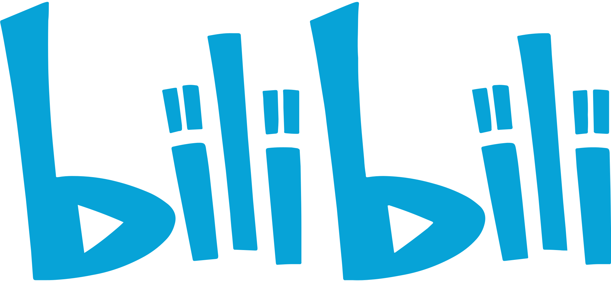

# Study Is Wonderful

**A multidisciplinary collection of open courses and technical blogs**

[简体中文](README.md) | [English](README.en.md)

> Discover great courses and technical articles across disciplines. Whether you are building foundations or exploring something new, come learn, share, and grow with us!

> This project is maintained again. [Issues](https://github.com/xioacd99/study-is-wonderful/issues) and [pull requests](https://github.com/xioacd99/study-is-wonderful/pulls) are welcome for recommendations, corrections, and improvements.

## Contents

- [Math](#math)
- [Computer Science](#computer-science)
- [Artificial Intelligence](#artificial-intelligence)
- [Economics](#economics)
- [Physics](#physics)
- [Psychology](#psychology)
- [Social Sciences](#social-sciences)
- [Biology](#biology)
- [Philosophy and Arts](#philosophy-and-arts)
- [Others](#others)
- [Technical blogs](#technical-blogs)

## Math

- [Mathematical Thinking](https://www.bilibili.com/BV1dq4y127TF) 
  > Related Stanford Math 56 introduces mathematical thinking, proofs and logical reasoning. [Reference](https://bulletin.stanford.edu/courses/2226181)

- [Convex Optimization](https://www.bilibili.com/BV1Pg4y187Ed)  · [Official video reference](https://see.stanford.edu/Course/EE364A/85) 
  > The related official course Stanford EE364A covers Convex sets and functions, Duality and interior-point methods. [Reference](https://see.stanford.edu/Course/EE364A)

- [The Fourier Transform and Its Applications](https://www.bilibili.com/BV1Qx411J7ER) 
  > The related official course Stanford EE261 covers Fourier series and transforms, Convolution, sampling and FFT. [Reference](https://see.stanford.edu/Course/EE261)

- [Matrix Theory and Applications](https://www.bilibili.com/BV17h411W7bk) 
  > The related official course Stanford ENGR108 covers Vectors and matrices, Linear equations and least squares. [Reference](https://web.stanford.edu/class/engr108/index.html)

- [Convex Optimization](https://www.bilibili.com/BV12x411z7ot) 
  > Related CMU 15-759 treats convex optimization theory, including gradient descent and interior-point methods. [Reference](https://csd.cmu.edu/course/15759/s25)

- [Advanced Optimization and Stochastic Methods](https://www.bilibili.com/BV1J64y1F7nW) 
  > Related CMU 12-768 covers large-scale and stochastic optimization and queueing theory under uncertainty. [Reference](https://cee.engineering.cmu.edu/education/course-descriptions/12-768.html)

- [Discrete Differential Geometry](https://www.bilibili.com/BV1RQ4y1Z7HL) 
  > Related CMU 15-458 combines differential geometry and computation to study curves, surfaces, curvature and geometry processing. [Reference](https://csd.cs.cmu.edu/course/15458/s24)

- [Optimization Methods](https://www.bilibili.com/BV19y4y1W7X1) 
  > Related Berkeley EECS 127 introduces optimization models and their applications in machine learning and decision-making. [Reference](https://www2.eecs.berkeley.edu/Courses/EECS127/)

- [Numerical Analysis](https://www.bilibili.com/BV1gv411j7rd) 
  > Related Berkeley Math 128A covers interpolation, numerical differentiation and integration, and direct methods for linear systems. [Reference](https://persson.berkeley.edu/math128a/)

- [Stochastic Processes](https://www.bilibili.com/BV1qB4y1A7t3) 
  > Related Berkeley Stat 206a may cover Brownian motion, Markov processes and martingales; topics vary by year. [Reference](https://stat206a.berkeley.edu/)

- [Numerical Methods](https://www.bilibili.com/BV1sT4y1S7Aa) 
  > Related Oxford A7 introduces numerical methods for linear systems, function approximation and differential equations. [Reference](https://courses.maths.ox.ac.uk/course/view.php?id=4372)

- [Probability](https://www.bilibili.com/BV1kE41157pa) 
  > Related Harvard Stat 110 introduces probability as a tool for randomness and statistics, including random variables and distributions. [Reference](https://stat110.hsites.harvard.edu/about)

- [Abstract Algebra](https://www.bilibili.com/BV1Ds41167HE) 
  > Related Harvard Math 55A introduces abstract algebra, including group theory and linear algebra. [Reference](https://www.math.harvard.edu/course/mathematics-55a/)

- [Probability](https://www.bilibili.com/BV19s41167TE) 
  > Related MIT 18.600 introduces probability, random variables, and binomial, geometric and Poisson distributions. [Reference](https://ocw.mit.edu/courses/18-600-probability-and-random-variables-fall-2019/)

- [Applied Statistics](https://www.bilibili.com/BV14t411N7uw) 
  > Related MIT 18.05 introduces probability distributions, Bayesian inference, hypothesis testing and regression. [Reference](https://ocw.mit.edu/courses/18-05-introduction-to-probability-and-statistics-spring-2022/)

- [Discrete Stochastic Processes](https://www.bilibili.com/BV1Qs41167VS) 
  > The related official course MIT 6.262 covers Poisson processes and Markov chains, Renewal processes and martingales. [Reference](https://ocw.mit.edu/courses/6-262-discrete-stochastic-processes-spring-2011/video_galleries/video-lectures/)

- [Fourier Analysis](https://www.bilibili.com/BV1Qz4y167rb) 
  > Related MIT 18.103 covers Lebesgue integration, Fourier series and Fourier integrals. [Reference](https://ocw.mit.edu/courses/18-103-fourier-analysis-fall-2013/)

- [Linear Algebra](https://www.bilibili.com/BV1zx411g7gq)  · [Official video reference](https://ocw.mit.edu/courses/18-06-linear-algebra-spring-2010/video_galleries/video-lectures/) 
  > The related official course MIT 18.06 covers Matrices and linear algebra applications. [Reference](https://ocw.mit.edu/courses/18-06-linear-algebra-spring-2010/pages/syllabus/)

- [Linear Algebra](https://www.bilibili.com/BV1fi4y1x7AH) 
  > The related official course MIT 18.06 covers Matrices and linear algebra applications. [Reference](https://ocw.mit.edu/courses/18-06-linear-algebra-spring-2010/pages/syllabus/)

- [Discrete Mathematics](https://www.bilibili.com/BV1zh41167Uy) 
  > Related MIT 6.042J introduces logic, proofs, graph theory, counting and discrete probability. [Reference](https://ocw.mit.edu/courses/6-042j-mathematics-for-computer-science-fall-2010/)

- [Complex Analysis](https://www.bilibili.com/BV1EJ41147q3) 
  > The related official course MIT 18.04 covers Complex analytic functions, Applications in physics and engineering. [Reference](https://ocw.mit.edu/courses/18-04-complex-variables-with-applications-spring-2018/)

- [Differential Equations](https://www.bilibili.com/BV1eM4y1g7De) 
  > The related official course MIT 18.03SC covers First- and second-order differential equations, Fourier series and Laplace transforms. [Reference](https://www.ocw.mit.edu/courses/18-03sc-differential-equations-fall-2011/pages/syllabus/syllabus/)

- [Graph Theory and Additive Combinatorics](https://www.bilibili.com/BV1Ei4y1x73V) 
  > Related MIT 18.217 explores connections between graph theory and additive combinatorics, including Roth’s theorem and pseudorandom graphs. [Reference](https://ocw.mit.edu/courses/18-217-graph-theory-and-additive-combinatorics-fall-2019/pages/syllabus/)

- [Riemannian Geometry](https://www.bilibili.com/BV19T4y1M7W5) 
  > Related MIT 18.965 geometry covers Riemannian manifolds, curvature and differential forms. [Reference](https://math.mit.edu/classes/18.965/2017FA/)

- [Game Theory](https://www.bilibili.com/BV1Kt411h7Ep) 
  > The related official course Yale ECON 159 covers Strategic thinking and Nash equilibrium, Backward induction and asymmetric information. [Reference](https://oyc.yale.edu/economics/econ-159)

## Computer Science

- [Great Ideas in Theoretical Computer Science](https://www.bilibili.com/BV1Wh411y7V9) 
  > A similarly named official course explores algorithms, computability, graph theory, and proofs. [Reference](https://www.cs.cmu.edu/~arielpro/15251f15/schedule.html)

- [The Missing Semester of Your CS Education](https://www.bilibili.com/BV1x7411H7wa) 
  > A similarly named official course teaches practical development tools including the shell, command line, debugging, and version control. [Reference](https://missing.csail.mit.edu/)

- [CS50X Introduction to Computer Science](https://www.bilibili.com/BV1ER4y157uA) 
  > A similarly named official course introduces programming and computer science through Scratch, C, algorithms, data structures, Python, SQL, and web development. [Reference](https://cs50.harvard.edu/x/)

- [Programming Methodology](https://www.bilibili.com/BV1zs411h7t8) 
  > A similarly named official course introduces programming using Karel and Java, including control flow and program decomposition. [Reference](https://see.stanford.edu/Course/CS106A/194)

- [CS101](https://web.stanford.edu/class/cs101/) 
  > A similarly named official course introduces computer hardware, software, data, variables, and loops. [Reference](https://web.stanford.edu/class/cs101/)

- [Introduction to Computer Science and Programming in Python](https://ocw.mit.edu/courses/electrical-engineering-and-computer-science/6-0001-introduction-to-computer-science-and-programming-in-python-fall-2016/) 
  > A similarly named official course introduces Python programming with branching, loops, recursion, debugging, object-oriented programming, and efficiency. [Reference](https://www.ocw.mit.edu/courses/6-0001-introduction-to-computer-science-and-programming-in-python-fall-2016/pages/syllabus/)

- [Classical Algorithms](https://www.bilibili.com/BV1kf4y1w7Kn) 
  > Related MIT 6.046J teaches design and analysis of classical algorithms, including sorting, search trees, dynamic programming and graph algorithms. [Reference](https://ocw.mit.edu/courses/6-046j-design-and-analysis-of-algorithms-spring-2012/)

- [Introduction to Algorithms](https://www.bilibili.com/BV1fu41127MN) 
  > A similarly named official course covers data structures, sorting, graph search, and dynamic programming. [Reference](https://www.ocw.mit.edu/courses/6-006-introduction-to-algorithms-spring-2020/pages/syllabus/)

- [Advanced Data Structures](https://www.bilibili.com/BV1iE411n7yJ) 
  > Related MIT 6.851 studies advanced data structures, including persistent structures that retain and modify historical versions. [Reference](https://ocw.mit.edu/courses/6-851-advanced-data-structures-spring-2012/resources/session-1-persistent-data-structures/)

- [Advanced Algorithms](https://www.bilibili.com/BV11E411u73m) 
  > Related MIT graduate course 6.854J covers advanced design methods including randomization, network flows and approximation algorithms. [Reference](https://ocw.mit.edu/courses/6-854j-advanced-algorithms-fall-2005/)

- [Data Structures and Algorithm Design](https://www.bilibili.com/BV1sf4y1H7vb) 
  > Related MIT 6.046J covers search trees, hashing, divide and conquer, dynamic programming and graph algorithms. [Reference](https://ocw.mit.edu/courses/6-046j-design-and-analysis-of-algorithms-spring-2012/)

- [CS 61B](https://inst.eecs.berkeley.edu/~cs61b/sp20/index.html) 
  > A similarly named official course covers data structures and their use in software. [Reference](https://inst.eecs.berkeley.edu/~cs61b/sp20/index.html)

- [CS106B Programming Abstractions](https://web.stanford.edu/class/cs106b/) 
  > A similarly named official course covers abstract data types, recursion, pointers, and dynamic memory using C++. [Reference](https://web.stanford.edu/class/archive/cs/cs106b/cs106b.1244/)

- [CSE 373 "The Algorithm Design Manual"](https://www3.cs.stonybrook.edu/~skiena/373/videos/) 
  > A similarly named official course covers algorithm analysis, searching, sorting, graph algorithms, complexity, and NP-completeness. [Reference](https://www3.cs.stonybrook.edu/~skiena/373/videos/)

- [Introduction to Computer Systems](https://www.bilibili.com/BV1uK4y1e7ep) 
  > Related CMU 15-213 covers machine-level code, memory management, networking and concurrency. [Reference](https://csd.cs.cmu.edu/15213-introduction-to-computer-systems)

- [Operating System and Systems Programming](https://www.bilibili.com/BV1ix411676b) 
  > Related Berkeley CS 162 covers processes, synchronization, memory management and file systems. [Reference](https://www2.eecs.berkeley.edu/Courses/CS162/)

- [Operating Systems](https://www.bilibili.com/BV1QA411F7ij) 
  > Related MIT 6.1810 teaches operating-system design using xv6, including virtual memory, threads and file systems. [Reference](https://pdos.csail.mit.edu/6.1810/2025/overview.html)

- [Distributed Systems](https://www.bilibili.com/BV1CU4y1P7PE) 
  > Related MIT 6.5840 studies fault tolerance, replication and consistency in distributed systems. [Reference](https://pdos.csail.mit.edu/6.824/index.html)

- [Computer Systems Security](https://www.bilibili.com/BV1jt411F7Wh) 
  > Related MIT 6.858 explores the design and implementation of secure computer systems. [Reference](https://css.csail.mit.edu/6.858/2019/general.html)

- [CS 61C](https://inst.eecs.berkeley.edu/~cs61c/fa20/) 
  > Related Berkeley CS 61C introduces computer architecture and machine structures. [Reference](https://notes.cs61c.org/)

- [15-213](https://www.bilibili.com/video/BV1iW411d7hd)  · [Link 2](http://www.cs.cmu.edu/~213/) 
  > A similarly named official course explores machine-level code, performance, memory, networks, and concurrency. [Reference](https://csd.cs.cmu.edu/15213-introduction-to-computer-systems)

- [CS 107](http://web.stanford.edu/class/cs107/) 
  > A similarly named official course explores C, data representation, machine code, compilation, and memory. [Reference](https://web.stanford.edu/class/archive/cs/cs107/cs107.1214/index)

- [Operating Systems](https://space.bilibili.com/202224425/channel/collectiondetail?sid=192498) 
  > A related Nanjing University operating systems course covers processes, threads, scheduling, memory management, synchronization and file systems. [Reference](https://gist.nju.edu.cn/course-os/)

- [CMU·Applied Data Science](https://www.bilibili.com/BV1Pa411F7VP) 
  > Course introduction coming soon.

- [UC Berkeley·Principles and Techniques of Data Science](https://www.bilibili.com/BV19741117jR) 
  > The official Berkeley Data 100 syllabus covers data cleaning, visualization, statistical inference and predictive modeling. [Reference](https://ds100.org/sp21/syllabus/)

- [Caltech·Data-Driven Algorithm Design](https://www.bilibili.com/BV1ip4y1X7uY) 
  > Course introduction coming soon.

- [Stanford·Introduction to Big Data](https://www.bilibili.com/BV1SC4y187x1) 
  > A third-party index identifies the original video as Stanford CS246, whose materials cover massive-data mining and data streams. [Reference](https://web.stanford.edu/class/cs246/slides/01-intro.pdf)

- [Harvard·Big Data Algorithms](https://www.bilibili.com/BV1v54y1x7dQ) 
  > Course introduction coming soon.

- [Stanford·CS 246](http://web.stanford.edu/class/cs246/) 
  > Stanford CS246 studies mining massive datasets, including data streams and related algorithms. The original catalog links to the course site, whose edition may change. [Reference](https://web.stanford.edu/class/cs246/slides/01-intro.pdf)

- [CMU·Introduction to Database Systems](https://www.bilibili.com/BV1Cp4y1C7dv) 
  > A related CMU course introduces database internals, including data models, indexes, queries, and transactions. [Reference](https://15445.courses.cs.cmu.edu/spring2025/)

- [CMU·Database Systems](https://www.bilibili.com/BV1rN411f7Ef) 
  > A related CMU course studies advanced database system design and implementation. [Reference](https://db.cs.cmu.edu/courses/)

- [UC Berkeley·Introduction to Databases](https://www.bilibili.com/BV1yb4y1n7rb) 
  > Related Berkeley CS186 materials cover transactions, concurrency control and recovery. [Reference](https://cs186berkeley.net/notes/note11/)

- [CMU·Parallel Computer Architecture and Programming](https://www.bilibili.com/BV16k4y1z7z9) 
  > CMU 15-418 combines parallel hardware and software design, including synchronization, communication, shared memory and message passing. [Reference](https://www.cs.cmu.edu/afs/cs/academic/class/15418-s11/public/info/syllabus.pdf)

- [UC Berkeley·Applications of Parallel Computing](https://www.bilibili.com/BV1qV411q7RS) 
  > Berkeley CS267’s 2016 syllabus covers parallel models including shared memory, MPI, GPUs and cloud computing. [Reference](https://people.eecs.berkeley.edu/~demmel/cs267_Spr16/Syllabus.html)

- [UC Berkeley·Introduction to Parallel Programming](https://www.bilibili.com/BV1QQ4y1o7rn) 
  > Course introduction coming soon.

- [Cornell·Software Engineering](https://www.bilibili.com/BV1aW411E7yr) 
  > Cornell CS5150 uses team projects to practice software lifecycles, requirements, design and testing. [Reference](https://www.cs.cornell.edu/courses/cs5150/2020sp/projects.html)

- [CMU·Software Engineering for Intelligent Systems](https://www.bilibili.com/BV1qA411n7X5) 
  > A related CMU course addresses requirements, data and infrastructure engineering for systems with machine-learning components, including fairness. [Reference](https://www.cs.cmu.edu/~ckaestne/pdf/seai19.pdf)

- [Stanford·Compilers](https://www.bilibili.com/BV1NW41177q4) 
  > A related Stanford CS143 course covers lexical analysis, parsing, type checking and code generation. The original link is reused for statistical learning and [Reference](https://web.stanford.edu/class/cs143/) This link is reused for two different entries; its target needs verification.

- [Cornell·Advanced Compilers](https://www.bilibili.com/BV1hZ4y1L7X4) 
  > A related Cornell course covers intermediate representations, data-flow analysis, optimization, and just-in-time compilation. [Reference](https://www.cs.cornell.edu/courses/cs6120/2025fa/self-guided/)

- [CMU·Computer Networks](https://www.bilibili.com/BV1wT4y1A7cd) 
  > CMU 15-441 covers network architecture, routing, congestion control and network security. [Reference](https://www.csd.cs.cmu.edu/course/15441/f25)

- [Stanford·Computer Networks](https://www.bilibili.com/BV137411Z7LR) 
  > A related Stanford CS144 assignment teaches networking protocols by implementing a TCP receiver. [Reference](https://cs144.github.io/assignments/check2.pdf)

- [Stanford·Network Security](https://www.bilibili.com/BV1yA411s7Tp) 
  > Course introduction coming soon.

- [CMU·Computer Graphics](https://www.bilibili.com/BV1QZ4y1K7ga) 
  > A related CMU graphics course covers rasterization, geometric transforms, ray tracing, and animation. [Reference](https://graphics.cs.cmu.edu/courses/)

- [Lingqi Yan·Introduction to Modern Computer Graphics](https://www.bilibili.com/BV1X7411F744) 
  > GAMES101 course materials cover graphics fundamentals including rasterization, ray tracing, geometry and animation. [Reference](https://lingqiyan.github.io/ucsb-assets/teaching/games101.html)

- [MIT·Computer Graphics](https://www.bilibili.com/BV167411g7iK) 
  > A related MIT 6.837 course introduces graphics algorithms, real-time rendering, graphics hardware and OpenGL. [Reference](https://ocw.mit.edu/courses/6-837-computer-graphics-fall-2012/pages/syllabus/)

- [CMU·Human-Computer Interaction Lecture Series](https://www.bilibili.com/BV1Bb411v7YH) 
  > The related CMU Human-Computer Interaction Institute seminar series shares HCI research and offers recordings of many past talks. [Reference](https://hcii.cmu.edu/seminar-series)

- [Princeton·Bitcoin and Cryptocurrency Technologies](https://www.bilibili.com/BV1FL411K7vK) 
  > The related Princeton course examines Bitcoin’s technical foundations, security, anonymity and real-world implications. [Reference](https://online.princeton.edu/bitcoin-and-cryptocurrency-technologies)

- [Stanford·Cryptography](https://www.bilibili.com/BV1Ht411w7Re) 
  > Related Stanford CS255 introduces symmetric and public-key encryption, message integrity and digital signatures. [Reference](https://crypto.stanford.edu/~dabo/courses/cs255_winter25/overview.html)

- [Stanford·Programming Abstractions in C++](https://www.bilibili.com/BV1G7411k7jG) 
  > Related Stanford CS106B uses C++ to teach recursion, data abstraction and fundamental data structures. [Reference](https://see.stanford.edu/Course/CS106B)

- [MIT·Structure and Interpretation of Computer Programs](https://www.bilibili.com/BV1AA411t7Wk) 
  > Related MIT 6.001 uses Scheme and covers data abstraction and higher-order procedures. [Reference](https://ocw.mit.edu/courses/6-001-structure-and-interpretation-of-computer-programs-spring-2005/pages/readings/)

- [MIT·Signals and Systems](https://www.bilibili.com/BV1L4411H7w3) 
  > Related MIT material introduces signals, system models, and Fourier transforms. [Reference](https://ocw.mit.edu/courses/6-011-introduction-to-communication-control-and-signal-processing-spring-2010/)

- [Oppenheim·MIT·Signals and Systems](https://www.bilibili.com/BV1CZ4y1j7hs) 
  > A related MIT course taught by Alan Oppenheim introduces signals and systems. [Reference](https://ocw.mit.edu/courses/res-6-007-signals-and-systems-spring-2011/)

- [MIT·Computation Structures](https://www.bilibili.com/BV197411s736) 
  > Related MIT 6.004 introduces digital systems from logic gates and circuits to processors. [Reference](https://ocw.mit.edu/courses/6-004-computation-structures-spring-2009/)

- [MIT·Python Programming](https://www.bilibili.com/BV1mq4y1u7NB) 
  > Related MIT 6.0001 introduces computational thinking and small Python programs to beginners. [Reference](https://ocw.mit.edu/courses/6-0001-introduction-to-computer-science-and-programming-in-python-fall-2016/)

- [MIT·Blockchain and Money](https://www.bilibili.com/BV1pK4y1r7Jf) 
  > Related MIT 15.S12 examines Bitcoin, blockchains, distributed ledgers and financial applications. [Reference](https://ocw.mit.edu/courses/15-s12-blockchain-and-money-fall-2018/)

## Artificial Intelligence

- [CMU·Artificial Intelligence (Graduate)](https://www.bilibili.com/BV1pC4y1t7px) 
  > Related CMU 15-780 covers search, planning, optimization, deep learning and multi-agent systems. [Reference](https://csd.cs.cmu.edu/course/15780/s25)

- [Hung-yi Lee·Deep Learning Theory](https://www.youtube.com/watch?v=KKT2VkTdFyc&list=RDLVKKT2VkTdFyc&start_radio=1&rv=KKT2VkTdFyc&t=5) 
  > An NTU syllabus identifies the original video as a lecture on shallow networks’ function-fitting ability; related lectures examine depth, loss surfaces and generalization. [Reference](https://nol.ntu.edu.tw/nol/coursesearch/print_table.php?class=02&course_id=921+U2620&dpt_code=9420&semester=108-2&ser_no=95134)

- [Hung-yi Lee·Next Step of Machine Learning](https://www.youtube.com/watch?v=XnyM3-xtxHs&list=PLJV_el3uVTsOK_ZK5L0Iv_EQoL1JefRL4) 
  > Course introduction coming soon.

- [Hung-yi Lee·Advanced Topics in Deep Learning](https://www.youtube.com/watch?v=IzHoNwlCGnE&list=PLJV_el3uVTsPMxPbjeX7PicgWbY7F8wW9) 
  > Course introduction coming soon.

- [Hung-yi Lee·Machine Learning-v1](https://www.youtube.com/watch?v=CXgbekl66jc&list=PLJV_el3uVTsPy9oCRY30oBPNLCo89yu49)  · [Hung-yi Lee·Machine Learning-v2](https://www.youtube.com/watch?v=Ye018rCVvOo&list=PLJV_el3uVTsMhtt7_Y6sgTHGHp1Vb2P2J)  · [Hung-yi Lee·Machine Learning-v1](https://www.youtube.com/watch?v=7XZR0-4uS5s&list=PLJV_el3uVTsPM2mM-OQzJXziCGJa8nJL8)  · [Hung-yi Lee·Machine Learning: TA Supplement](https://www.youtube.com/watch?v=eybCCtNKwzA&list=PLJV_el3uVTsM8QoIIe9JrSDjB0e1UkbEC) 
  > An NTU syllabus cites one of the original playlists, covering machine-learning fundamentals, backpropagation and neural-network training. [Reference](https://nol.ntu.edu.tw/nol/coursesearch/print_table.php?class=02&course_id=921+U2620&dpt_code=9420&semester=108-2&ser_no=95134)

- [MIT·Deep Learning](https://www.bilibili.com/BV1qt411c7Na) 
  > Related MIT 6.7960 covers neural architectures, backpropagation, generalization and applications in vision and language. [Reference](https://ocw.mit.edu/courses/6-7960-deep-learning-fall-2024/)

- [MIT·Machine Learning](https://www.bilibili.com/BV1a7411M7wH) 
  > MIT 18.065 uses linear algebra to study matrix methods in probability, statistics, optimization, and deep learning. The original video may correspond to this course, but has not been directly verified. [Reference](https://ocw.mit.edu/courses/18-065-matrix-methods-in-data-analysis-signal-processing-and-machine-learning-spring-2018/)

- [Stanford·Principles and Techniques of Artificial Intelligence](https://www.bilibili.com/BV1Ht4y1U75j) 
  > Related Stanford CS221 introduces search, machine learning, Markov decision processes and graphical models. [Reference](https://web.stanford.edu/class/archive/cs/cs221/cs221.1186/index.html)

- [Berkeley·CS 188](https://inst.eecs.berkeley.edu//~cs188/fa19/) 
  > Berkeley’s CS 188 syllabus introduces AI through search, games, probabilistic inference and machine learning. The cited syllabus is not the original 2019 course page. [Reference](https://inst.eecs.berkeley.edu/~cs188/assets/cs188-syllabus-print-version.pdf)

- [Berkeley·CS 189](https://www.eecs189.org/) 
  > The current Berkeley CS 189 course covers clustering, dimensionality reduction, regression, classification and neural networks, combining theory and applications. [Reference](https://eecs189.org/)

- [Hung-yi Lee·GAN-2018](https://www.youtube.com/watch?v=DQNNMiAP5lw&list=PLJV_el3uVTsMq6JEFPW35BCiOQTsoqwNw)  · [Hung-yi Lee·GAN-2017](https://www.youtube.com/watch?v=G0dZc-8yIjE&list=PLJV_el3uVTsMd2G9ZjcpJn1YfnM9wVOBf) 
  > A mirrored listing of the 2018 series includes conditional generation, GAN theory, WGAN and sequence generation. The 2017 playlist has not been independently verified. [Reference](https://www.bilibili.com/video/BV1Bg4y187WC/)

- [CMU·Natural Language Processing](https://www.bilibili.com/BV1dC4y1h788) 
  > Related CMU 11-411/611 introduces practical natural language processing applications using language models. [Reference](https://www.cs.cmu.edu/~ehn/11-611/)

- [Stanford·Deep Natural Language Processing](https://www.bilibili.com/BV1pt411h7aT) 
  > Stanford CS224N introduces neural approaches to natural language processing through assignments and projects. [Reference](https://web.stanford.edu/class/cs224n/)

- [CMU·Advanced Natural Language Processing](https://www.bilibili.com/BV1H3411k7GA) 
  > The related CMU course 11-711 covers syntactic, semantic and discourse analysis, neural modeling and a research project. [Reference](https://lti.cmu.edu/misc-pages/intranet-course-info.html)

- [Hung-yi Lee·Deep Learning for Human Languange Processing](https://www.youtube.com/watch?v=nER51ZyJaCQ&list=PLJV_el3uVTsO07RpBYFsXg-bN5Lu0nhdG) 
  > Hung-yi Lee’s related NTU course applies deep learning to speech and text processing. [Reference](https://gice.ntu.edu.tw/courses/CSP_group_courses/60_Deep_Learning_for_Human_Language_Processing.pdf)

- [Hung-yi Lee·Deep Reinforcement Learning](https://www.youtube.com/watch?v=z95ZYgPgXOY&list=PLJV_el3uVTsODxQFgzMzPLa16h6B8kWM_) 
  > A mirrored listing matching the original link includes lectures on policy gradients, PPO and Q-learning. [Reference](https://www.bilibili.com/video/BV1wb41127KH/)

- [Stanford·Reinforcement Learning](https://www.bilibili.com/BV1sb411s7eQ) 
  > Stanford CS234 introduces decision-making, exploration and generalization in reinforcement learning. [Reference](https://web.stanford.edu/class/archive/cs/cs234/cs234.1176/index.html)

- [MIT·Identification, Estimation, and Learning](https://www.bilibili.com/BV1KL4y1e7F7) 
  > Related MIT 2.160 covers least-squares estimation, Kalman filtering and system identification. [Reference](https://ocw.mit.edu/courses/2-160-identification-estimation-and-learning-spring-2006/)

- [UC Berkeley·Deep Reinforcement Learning](https://www.bilibili.com/BV1fx411S7S8) 
  > A related Berkeley deep reinforcement learning course covers imitation learning, policy gradients, Q-learning and actor-critic methods. [Reference](https://rail.eecs.berkeley.edu/deeprlcourse/)

- [UC Berkeley·Statistical Machine Learning](https://www.bilibili.com/BV1KA41157yn) 
  > Related Berkeley STAT 154 covers statistical learning, data analysis, regression and classification. [Reference](https://www.stat.berkeley.edu/~songmei/Teaching/STAT154_Fall2021/index.html)

- [Stanford·Statistical Learning](https://www.bilibili.com/BV1NW41177q4) 
  > A related statistical learning course covers regression, classification, resampling, regularization and tree-based methods. [Reference](https://www.statlearning.com/online-courses) This link is reused for two different entries; its target needs verification.

- [CMU·Machine Learning for Structured Data](https://www.bilibili.com/BV1MK4y1a7PS) 
  > Related CMU 10-418/618 studies structured prediction using probabilistic graphical models, inference and deep learning. [Reference](https://www.cs.cmu.edu/~mgormley/courses/10418/syllabus.html)

- [Caltech·Foundations of Machine Learning and Statistical Inference](https://www.bilibili.com/BV1uA411n7oV) 
  > Related Caltech course Learning From Data introduces machine-learning theory, algorithms and applications. [Reference](https://home.work.caltech.edu/telecourse)

- [Hung-yi Lee·Structured Learning](https://www.youtube.com/watch?v=5OYu0vxXEv8&list=PLJV_el3uVTsNHQKxv49vpq7NSn-zim18V) 
  > Hung-yi Lee’s related course lists structured learning and sequence labeling; his research illustrates structured inputs and outputs with speech recognition. [Reference](https://speech.ee.ntu.edu.tw/~tlkagk/courses_ML16.html)

- [Stanford·Machine Learning with Graphs](https://www.bilibili.com/BV1Vg4y1z7Nf) 
  > The 2019 Stanford CS224W syllabus covers node classification and representations, graph neural networks, PageRank and community detection. [Reference](https://web.stanford.edu/class/cs224w/handouts/CS224W_Info_Handout.pdf)

- [Stanford·Robotics](https://www.bilibili.com/BV16s411q7o7) 
  > Related Stanford CS223A introduces robot kinematics, dynamics and control. [Reference](https://cs.stanford.edu/group/manips/teaching/cs223a/)

- [MIT·Machine Learning for Healthcare](https://www.bilibili.com/BV1oa411c7eD) 
  > Related MIT 6.S897 studies clinical data, disease prediction, interpretability and fairness in healthcare machine learning. [Reference](https://ocw.mit.edu/courses/6-s897-machine-learning-for-healthcare-spring-2019/pages/syllabus/)

## Economics

- [Financial Markets](https://www.bilibili.com/BV1ab411b7jq) 
  > Related Yale ECON 252 introduces risk management, behavioral finance, securities, insurance and banking. [Reference](https://oyc.yale.edu/economics/econ-252)

- [Microeconomics](https://www.bilibili.com/BV1MV411U75D) 
  > Related MIT course 14.01SC introduces microeconomics through supply, demand and price changes; [Reference](https://ocw.mit.edu/courses/14-01sc-principles-of-microeconomics-fall-2011/pages/unit-1-supply-and-demand/)

- [Financial Theory](https://www.bilibili.com/BV1Ft4112796) 
  > Related MIT 15.401 introduces asset valuation, portfolio theory and risk analysis. [Reference](https://ocw.mit.edu/courses/15-401-finance-theory-i-fall-2008/pages/syllabus/)

- [Behavioral Economics](https://www.bilibili.com/BV11U4y1g78u) 
  > Related MIT 14.13 uses psychology to examine departures of human behavior from assumptions in economic models. [Reference](https://ocw.mit.edu/courses/14-13-psychology-and-economics-spring-2020/)

## Physics

- [Quantum Mechanics](https://www.bilibili.com/BV1w4411s7da) 
  > Related Stanford PHYSICS 130 covers wavefunctions, the Schrödinger equation, observables and angular momentum. [Reference](https://bulletin.stanford.edu/courses/1226821)

- [General Relativity](https://www.bilibili.com/BV1tE411R75K) 
  > Related Stanford PHYSICS 262 covers curved spacetime, Einstein field equations and applications including black holes. [Reference](https://bulletin.stanford.edu/courses/1227311)

- [String Theory and M Theory](https://www.bilibili.com/BV1CE411Q7Cc) 
  > A related Stanford physics course introduces perturbative string theory, including bosonic and superstrings. [Reference](https://explorecourses.stanford.edu/m_search?filter-catalognumber-PHYSICS=on&filter-term-Spring=on&page=3&q=PHYSICS)

## Psychology

- [Psychological Statistics](https://www.bilibili.com/BV1UJ411c7d8) 
  > Related Berkeley Psychology 102 introduces data analysis and hypothesis testing in psychological research. [Reference](https://psychology.berkeley.edu/sites/default/files/psych_102_-_generic_2018.pdf)

- [Social and Cognitive Psychology](https://www.bilibili.com/BV1Hx411u7SK) 
  > Related Berkeley Psychology 164 connects social, personality and clinical psychology with cognitive research. [Reference](https://undergraduate.catalog.berkeley.edu/courses/1196731)

- [Introduction to Psychology](https://www.bilibili.com/BV1Ps411Z7h1)  · [Official video reference](https://oyc.yale.edu/psychology/psyc-110/lecture-1) 
  > Related Yale course PSYC 110 introduces neuroscience and developmental, cognitive, social and clinical psychology; [Reference](https://oyc.yale.edu/psychology/psyc-110/lecture-1)

- [Positive Psychology](https://www.bilibili.com/BV1ga41127Zt) 
  > A related Harvard positive psychology course introduces mindfulness, personal strengths and positive relationships. [Reference](https://learn.hms.harvard.edu/programs/positive-psychology)

- [Introduction to Psychology](https://www.bilibili.com/BV1hZ4y1w7kd) 
  > Related Harvard PSYC S-1 surveys cognition, emotion, development, social and clinical psychology. [Reference](https://coursebrowser.dce.harvard.edu/course/introduction-to-psychology/)

- [Happiness Course](https://www.bilibili.com/BV1px411d7xr) 
  > Related Harvard course Managing Happiness examines well-being through positive psychology, neuroscience and philosophy. [Reference](https://pll.harvard.edu/course/managing-happiness)

## Social Sciences

- [Foundations of Modern Social Theory](https://www.bilibili.com/BV1ux411r736) 
  > Related Yale course SOCY 151 studies social thinkers including Hobbes, Marx, Weber and Durkheim; [Reference](https://oyc.yale.edu/sociology/socy-151)

- [Capitalism](https://www.bilibili.com/BV1x5411g7R5) 
  > Related Yale PLSC 270 examines capitalism and its social consequences through an evolutionary lens. [Reference](https://oyc.yale.edu/political-science/plsc-270)

- [Introduction to Political Philosophy](https://www.bilibili.com/BV1wx411y7uW) 
  > Related Yale course PLSC 114 examines the polis, sovereignty, constitutional government and democracy through major Western political thinkers; [Reference](https://oyc.yale.edu/political-science/plsc-114)

## Biology

- [Human Behavioral Biology](https://www.bilibili.com/BV1FF411Y72Y) 
  > Related Stanford BIO 150 draws on neuroscience, endocrinology and other disciplines to examine human behavior. [Reference](https://bulletin.stanford.edu/courses/1119251)

## Philosophy and Arts

- [Aesthetics](https://www.bilibili.com/BV1av411e778) 
  > A related Cambridge aesthetics course surveys philosophers’ definitions of beauty from antiquity to the present. [Reference](https://www.pace.cam.ac.uk/courses/component-courses/what-beautiful-introduction-aesthetics-0)

## Others

- [Geometric Folding Algorithms](https://www.bilibili.com/BV14q4y1R7Ra) 
  > Related MIT 6.849 studies algorithms and applications for linkages, origami and polyhedral folding. [Reference](https://ocw.mit.edu/courses/6-849-geometric-folding-algorithms-linkages-origami-polyhedra-fall-2012/)

- [How to Start a Startup](https://www.bilibili.com/BV1KK4y1s7mY) 
  > Related Stanford materials list startup lectures on products, teams, growth and fundraising. [Reference](https://pacscenter.stanford.edu/wp-content/uploads/2017/01/Designing-For-Philanthropy-Impact-The-Giving-Compass.pdf)

- [Scientific Paper Writing](https://www.bilibili.com/BV1zv41177JQ) 
  > Related Stanford course Writing in the Sciences teaches scientific writing and includes grant-writing guidance. [Reference](https://create.stanford.edu/resources/educational-resources)

- [Ou Lijuan on Dream of the Red Chamber](https://www.bilibili.com/BV1hp4y1t7zq) 
  > Ou Lijuan’s related National Taiwan University course examines Dream of the Red Chamber through culture and character; [Reference](https://ocw.aca.ntu.edu.tw/courses/101S120/)

- [Luo Xiang on Criminal Law](https://www.bilibili.com/BV1dj411f7vb) 
  > Course introduction coming soon.

- [Listening to Music](https://www.bilibili.com/BV1sW411a7nM) 
  > Related Yale course MUSI 112 introduces active listening, rhythm, melody, harmony and musical form; [Reference](https://oyc.yale.edu/music/musi-112/lecture-1)

- [Introduction to Literary Theory](https://www.bilibili.com/BV15s411x7LU) 
  > Related Yale course ENGL 300 introduces literary theory, including formalism, structuralism and deconstruction; [Reference](https://oyc.yale.edu/english/engl-300)

- [Managing Emotions](https://www.bilibili.com/BV1KK4y1P7Df) 
  > A related Yale course for school staff introduces strategies for identifying and managing emotions and understanding stress. [Reference](https://medicine.yale.edu/childstudy/services/community-and-schools-programs/center-for-emotional-intelligence/course/)

- [Introduction to Negotiation](https://www.bilibili.com/BV13T4y1L7AT) 
  > A related Yale introduction to negotiation teaches a framework for analyzing and shaping negotiation processes and outcomes. [Reference](https://som.yale.edu/programs/mba/curriculum/year-1-core)

## Technical blogs

No articles have been added yet.

