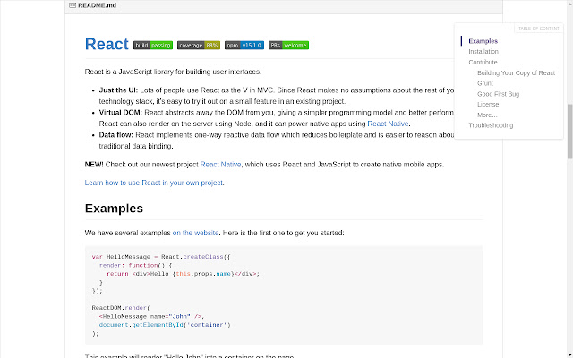

# Study Is Wonderful

**跨学科公开课与技术博客精选** 
**A multidisciplinary collection of open courses and technical blogs**

> 收集跨学科好课与技术文章，让学习更有趣。无论你想打好基础，还是探索新领域，都欢迎一起学习、分享与进步。
>
> Discover great courses and technical articles across disciplines. Whether you are building foundations or exploring something new, come learn, share, and grow with us!

> 本项目已恢复维护，欢迎通过 [Issue](https://github.com/xioacd99/study-is-wonderful/issues) 推荐资源或反馈问题，也欢迎提交 [Pull Request](https://github.com/xioacd99/study-is-wonderful/pulls)。
>
> This project is maintained again. [Issues](https://github.com/xioacd99/study-is-wonderful/issues) and [pull requests](https://github.com/xioacd99/study-is-wonderful/pulls) are welcome for recommendations, corrections, and improvements.

> 课程列表较长，推荐使用 Chrome 扩展 [Smart TOC](https://chrome.google.com/webstore/detail/smart-toc/lifgeihcfpkmmlfjbailfpfhbahhibba?utm_source=chrome-ntp-icon)，在页面右侧生成可跳转目录。
>
> For easier navigation through this long list, try the Chrome extension [Smart TOC](https://chrome.google.com/webstore/detail/smart-toc/lifgeihcfpkmmlfjbailfpfhbahhibba?utm_source=chrome-ntp-icon), which adds a navigable table of contents to the side of the page.

## 目录 Contents

- [数学 Math](#数学-math)
- [计算机科学 Computer Science](#计算机科学-computer-science)
- [人工智能 Artificial Intelligence](#人工智能-artificial-intelligence)
- [经济学 Economics](#经济学-economics)
- [物理学 Physics](#物理学-physics)
- [心理学 Psychology](#心理学-psychology)
- [社会科学 Social Sciences](#社会科学-social-sciences)
- [生物学 Biology](#生物学-biology)
- [哲学与艺术 Philosophy and Arts](#哲学与艺术-philosophy-and-arts)
- [其他 Others](#其他-others)
- [技术博客 Technical blogs](#技术博客-technical-blogs)

## 数学 Math

- [MIT 18.065·数据分析、信号处理与机器学习中的矩阵方法（2018 春季） / MIT 18.065·Matrix Methods in Data Analysis, Signal Processing, and Machine Learning (Spring 2018)](https://ocw.mit.edu/courses/18-065-matrix-methods-in-data-analysis-signal-processing-and-machine-learning-spring-2018/)（MIT OpenCourseWare） · [官方第一讲 / Official Lecture 1](https://www.youtube.com/watch?v=YiqIkSHSmyc)（YouTube）
  > 跟随 Gilbert Strang 学习矩阵分解、概率统计与优化，理解线性代数如何支撑数据分析和深度学习。
  >
  > Learn matrix factorizations, probability, statistics, and optimization with Gilbert Strang, and see how linear algebra supports data analysis and deep learning.

- [数学思维课 / Mathematical Thinking](https://www.bilibili.com/BV1dq4y127TF) 
  > 练习像数学家一样提问、推理，并用证明解释答案为什么成立。
  >
  > Practice asking questions, reasoning and explaining why an answer is true with a proof.

- [凸优化 / Convex Optimization](https://www.bilibili.com/BV1Pg4y187Ed) 
  > 认识利用凸性寻找最优解的方法，就像寻找碗底的最低点。
  >
  > Explore how convexity can help find an optimal solution, like finding the bottom of a bowl.

- [傅里叶变换及其应用 / The Fourier Transform and Its Applications](https://www.bilibili.com/BV1Qx411J7ER) 
  > 认识傅里叶变换如何把复杂信号拆成不同频率的成分。
  >
  > See how the Fourier transform breaks a complex signal into frequencies.

- [矩阵论与应用 / Matrix Theory and Applications](https://www.bilibili.com/BV17h411W7bk) 
  > 用向量和矩阵整齐地表示数据与方程，并探索它们的应用。
  >
  > Use vectors and matrices to organize data and equations and explore their applications.

- [凸优化 / Convex Optimization](https://www.bilibili.com/BV12x411z7ot) 
  > 学习用凸优化在满足限制的选择中寻找最好结果。
  >
  > Learn how convex optimization finds the best result among constrained choices.

- [最优化进阶与随机方法 / Advanced Optimization and Stochastic Methods](https://www.bilibili.com/BV1J64y1F7nW) 
  > 探索寻找最优解的方法，以及如何处理带有随机性的情况。
  >
  > Explore optimization methods and how to handle randomness.

- [离散微分几何 / Discrete Differential Geometry](https://www.bilibili.com/BV1RQ4y1Z7HL) 
  > 用离散的点和网格来研究曲线、曲面与几何形状。
  >
  > Study curves, surfaces and geometric shapes using discrete points and meshes.

- [最优化方法 / Optimization Methods](https://www.bilibili.com/BV19y4y1W7X1) 
  > 探索怎样在各种可能选择中找到符合条件的最优解。
  >
  > Explore how to find the best feasible solution among possible choices.

- [数值分析 / Numerical Analysis](https://www.bilibili.com/BV1gv411j7rd) 
  > 研究如何用计算机算出近似答案，并分析误差。
  >
  > Study how computers find approximate answers and how to analyze error.

- [随机过程 / Stochastic Processes](https://www.bilibili.com/BV1qB4y1A7t3) 
  > 研究随时间变化、结果带有不确定性的过程。
  >
  > Study processes that change over time with uncertain outcomes.

- [数值方法 / Numerical Methods](https://www.bilibili.com/BV1sT4y1S7Aa) 
  > 学习用数值计算近似解决难以直接求解的数学问题。
  >
  > Learn numerical ways to approximate solutions to hard mathematical problems.

- [概率论 / Probability](https://www.bilibili.com/BV1kE41157pa) 
  > 用概率描述不确定性，例如事情发生的可能性。
  >
  > Use probability to describe uncertainty, such as how likely an event is.

- [抽象代数 / Abstract Algebra](https://www.bilibili.com/BV1Ds41167HE) 
  > 研究群、环等抽象结构，以及其中运算遵循的规则。
  >
  > Study abstract structures such as groups and rings and the rules of their operations.

- [概率论 / Probability](https://www.bilibili.com/BV19s41167TE) 
  > 学习用概率和随机变量描述不确定的结果。
  >
  > Learn to describe uncertain outcomes using probability and random variables.

- [应用统计 / Applied Statistics](https://www.bilibili.com/BV14t411N7uw) 
  > 学习从数据中估计、比较并作出有依据的判断。
  >
  > Learn to estimate, compare and make informed judgments from data.

- [离散随机过程 / Discrete Stochastic Processes](https://www.bilibili.com/BV1Qs41167VS) 
  > 研究随机事件如何在一系列时刻或状态中演变。
  >
  > Study how random events evolve across times or states.

- [傅里叶分析 / Fourier Analysis](https://www.bilibili.com/BV1Qz4y167rb) 
  > 用频率的视角研究函数与信号，就像把声音分解成音调。
  >
  > Study functions and signals through frequencies, like breaking sound into tones.

- [线性代数 / Linear Algebra](https://www.bilibili.com/BV1zx411g7gq) 
  > 学习用向量和矩阵解决线性方程，理解空间中的方向。
  >
  > Use vectors and matrices to solve linear equations and understand directions in space.

- [线性代数 / Linear Algebra](https://www.bilibili.com/BV1fi4y1x7AH) 
  > 探索向量、矩阵和线性变换怎样描述数据与空间。
  >
  > Explore how vectors, matrices and linear transformations describe data and space.

- [离散数学 / Discrete Mathematics](https://www.bilibili.com/BV1zh41167Uy) 
  > 研究离散对象，例如逻辑命题、集合和由点线组成的图。
  >
  > Study discrete objects such as logical statements, sets and graphs of points and links.

- [复分析 / Complex Analysis](https://www.bilibili.com/BV1EJ41147q3) 
  > 探索包含虚数的复数和复函数如何帮助解决数学问题。
  >
  > Explore complex numbers and functions and how they help solve mathematical problems.

- [微分方程 / Differential Equations](https://www.bilibili.com/BV1eM4y1g7De) 
  > 用方程描述变化，例如物体的位置怎样随时间改变。
  >
  > Use equations to describe change, such as how an object’s position changes over time.

- [图论与可加组合学 / Graph Theory and Additive Combinatorics](https://www.bilibili.com/BV1Ei4y1x73V) 
  > 研究点和连线组成的图，以及数字集合相加产生的组合规律。
  >
  > Study graphs of points and links and patterns formed by adding sets of numbers.

- [黎曼几何 / Riemannian Geometry](https://www.bilibili.com/BV19T4y1M7W5) 
  > 研究弯曲空间中的距离与曲率，像理解地球表面的几何。
  >
  > Study distance and curvature in curved spaces, such as the surface of Earth.

- [博弈论 / Game Theory](https://www.bilibili.com/BV1Kt411h7Ep) 
  > 研究当每个人的选择都会影响别人时，如何分析策略。
  >
  > Study strategies when each person’s choices affect others.

## 计算机科学 Computer Science

- [MIT 6.172·软件系统性能工程（2018 秋季） / MIT 6.172·Performance Engineering of Software Systems (Fall 2018)](https://ocw.mit.edu/courses/6-172-performance-engineering-of-software-systems-fall-2018/)（MIT OpenCourseWare） · [官方第一讲 / Official Lecture 1](https://www.youtube.com/watch?v=o7h_sYMk_oc)（YouTube） · [转载 / Repost](https://www.bilibili.com/video/BV1wA411h7N7/)（Bilibili）
  > 从矩阵乘法优化等实例出发，学习分析程序性能，理解算法、编程语言与计算机系统如何影响运行速度。
  >
  > Learn to analyze program performance through examples such as matrix multiplication, and understand how algorithms, programming languages, and computer systems affect execution speed.

- [MIT·计算机教育中缺失的一课（2026） / MIT·The Missing Semester of Your CS Education (2026)](https://www.youtube.com/playlist?list=PLyzOVJj3bHQunmnnTXrNbZnBaCA-ieK4L)  · [中文配音转载 / Chinese-dubbed repost](https://www.bilibili.com/video/BV1JgACzjEo8/)  · [课程官网 / Course website](https://missing.csail.mit.edu/2026/)
  > 学习 Shell、开发工具、调试、Git、代码发布与质量管理，并了解智能体编程如何融入日常开发。
  >
  > Learn shell tools, development workflows, debugging, Git, software delivery, and code quality, including how agentic coding fits into everyday development.

- [理论计算机科学中的重要思想 / Great Ideas in Theoretical Computer Science](https://www.bilibili.com/BV1Wh411y7V9) 
  > 用数学的眼光认识计算机能解决什么问题，以及解决问题需要多少资源。
  >
  > Explore what computers can solve and how much work solutions require, using mathematical ideas.

- [计算机教育中缺失的一课 / The Missing Semester of Your CS Education](https://www.bilibili.com/BV1x7411H7wa) 
  > 认识程序员常用的工具，比如命令行、调试工具和版本管理。
  >
  > Meet tools programmers use, such as the command line, debuggers, and version control.

- [CS50X 计算机入门 / CS50X Introduction to Computer Science](https://www.bilibili.com/BV1ER4y157uA) 
  > 从零认识计算机科学与编程，学习如何把问题拆成计算机可以执行的步骤。
  >
  > Start learning computer science and programming by breaking problems into steps a computer can follow.

- [编程方法学 / Programming Methodology](https://www.bilibili.com/BV1zs411h7t8) 
  > 学习编程的方法，练习把一个大问题拆成容易处理的小步骤。
  >
  > Learn programming methods and practice breaking big problems into manageable steps.

- [CS101](https://web.stanford.edu/class/cs101/) 
  > 认识计算机的硬件、软件和数据，并接触变量与循环等编程概念。
  >
  > Meet computer hardware, software, and data, along with programming ideas such as variables and loops.

- [计算机科学与 Python 编程导论 / Introduction to Computer Science and Programming in Python](https://ocw.mit.edu/courses/electrical-engineering-and-computer-science/6-0001-introduction-to-computer-science-and-programming-in-python-fall-2016/) 
  > 用 Python 学习编程基础，练习用小程序解决问题。
  >
  > Learn programming basics in Python and practice solving problems with small programs.

- [经典算法 / Classical Algorithms](https://www.bilibili.com/BV1kf4y1w7Kn) 
  > 认识经典算法，了解计算机解决问题时可以采用的步骤。
  >
  > Explore classic algorithms, or step-by-step methods computers can use to solve problems.

- [算法导论 / Introduction to Algorithms](https://www.bilibili.com/BV1fu41127MN) 
  > 入门算法，学习如何设计解决问题的步骤并思考它们的效率。
  >
  > Get started with algorithms by thinking about steps for solving problems and how efficiently they work.

- [高级数据结构 / Advanced Data Structures](https://www.bilibili.com/BV1iE411n7yJ) 
  > 学习高级数据结构，也就是组织和使用数据的进阶方法。
  >
  > Explore advanced data structures, or more sophisticated ways to organize and use data.

- [高级算法 / Advanced Algorithms](https://www.bilibili.com/BV11E411u73m) 
  > 学习高级算法，探索解决计算问题的进阶方法。
  >
  > Explore advanced algorithms and more sophisticated ways to solve computational problems.

- [数据结构与算法设计 / Data Structures and Algorithm Design](https://www.bilibili.com/BV1sf4y1H7vb) 
  > 学习如何组织数据并设计算法，让程序有条理地解决问题。
  >
  > Learn how to organize data and design algorithms that help programs solve problems systematically.

- [CS 61B](https://inst.eecs.berkeley.edu/~cs61b/sp20/index.html) 
  > 学习数据结构，也就是让程序存放、查找和处理数据的方法。
  >
  > Learn data structures, the ways programs store, find, and work with data.

- [CS106B 编程抽象 / CS106B Programming Abstractions](https://web.stanford.edu/class/cs106b/) 
  > 用编程抽象把复杂问题拆开，学习递归和数据结构等解决问题的工具。
  >
  > Use programming abstractions to manage complexity and learn tools such as recursion and data structures.

- [CSE 373《算法设计手册》 / CSE 373 "The Algorithm Design Manual"](https://www3.cs.stonybrook.edu/~skiena/373/videos/) 
  > 学习分析算法，比较搜索、排序和图算法等方法需要多少时间与空间。
  >
  > Analyze algorithms by comparing the time and space needed for searching, sorting, graph algorithms, and more.

- [计算机系统介绍 / Introduction to Computer Systems](https://www.bilibili.com/BV1uK4y1e7ep) 
  > 认识计算机系统，探索软件和硬件如何协作运行程序。
  >
  > Explore computer systems and how software and hardware work together to run programs.

- [操作系统与系统编程 / Operating System and Systems Programming](https://www.bilibili.com/BV1ix411676b) 
  > 认识操作系统如何为程序提供运行环境，并了解系统编程。
  >
  > Explore how operating systems provide an environment for programs and learn about systems programming.

- [操作系统 / Operating Systems](https://www.bilibili.com/BV1QA411F7ij) 
  > 学习操作系统的基本概念，认识管理计算机资源的软件。
  >
  > Learn the basic ideas behind operating systems, the software that manages computer resources.

- [分布式系统 / Distributed Systems](https://www.bilibili.com/BV1CU4y1P7PE) 
  > 认识分布式系统，探索多台计算机如何协作完成任务。
  >
  > Explore distributed systems and how multiple computers work together on tasks.

- [计算机系统安全 / Computer Systems Security](https://www.bilibili.com/BV1jt411F7Wh) 
  > 学习计算机系统安全，认识保护系统和信息的基本问题。
  >
  > Explore computer systems security and the basic challenges of protecting systems and information.

- [CS 61C](https://inst.eecs.berkeley.edu/~cs61c/fa20/) 
  > 通过伯克利 CS 61C 课程学习计算机科学。
  >
  > Study computer science through Berkeley’s CS 61C course.

- [15-213](https://www.bilibili.com/video/BV1iW411d7hd)  · [课程网页 / Link 2](http://www.cs.cmu.edu/~213/) 
  > 从程序员的角度认识计算机系统，了解机器代码、内存和网络等概念。
  >
  > See computer systems from a programmer’s perspective, including machine code, memory, and networking.

- [CS 107](http://web.stanford.edu/class/cs107/) 
  > 走近计算机内部，学习 C 语言、内存和机器代码如何影响程序运行。
  >
  > Look inside computer systems and learn how C, memory, and machine code shape program execution.

- [操作系统 / Operating Systems](https://space.bilibili.com/202224425/channel/collectiondetail?sid=192498) 
  > 学习操作系统的基本概念，认识管理计算机资源的软件。
  >
  > Learn the basic ideas behind operating systems, the software that manages computer resources.

- [CMU·应用数据科学 / CMU·Applied Data Science](https://www.bilibili.com/BV1Pa411F7VP) 
  > 了解怎样用数据和计算方法解决实际问题。
  >
  > Explore how data and computational methods can help solve practical problems.

- [加州伯克利·数据科学原理与技术 / UC Berkeley·Principles and Techniques of Data Science](https://www.bilibili.com/BV19741117jR) 
  > 学习清理、分析和展示数据，并用数据建立预测。
  >
  > Explore how to clean, analyze and visualize data, and use it to make predictions.

- [加州理工·数据驱动算法设计 / Caltech·Data-Driven Algorithm Design](https://www.bilibili.com/BV1ip4y1X7uY) 
  > 探索如何利用数据帮助设计算法。
  >
  > Explore how data can help guide the design of algorithms.

- [斯坦福·大数据概论 / Stanford·Introduction to Big Data](https://www.bilibili.com/BV1SC4y187x1) 
  > 了解如何处理和挖掘大规模数据。
  >
  > Explore how to process and mine large datasets.

- [哈佛·大数据算法 / Harvard·Big Data Algorithms](https://www.bilibili.com/BV1v54y1x7dQ) 
  > 探索处理大量数据时使用的算法。
  >
  > Explore algorithms for working with large amounts of data.

- [斯坦福·CS 246 / Stanford·CS 246](http://web.stanford.edu/class/cs246/) 
  > 学习从海量数据中寻找有用模式的方法。
  >
  > Explore methods for finding useful patterns in massive datasets.

- [CMU·数据库系统介绍 / CMU·Introduction to Database Systems](https://www.bilibili.com/BV1Cp4y1C7dv) 
  > 了解数据库如何存储数据，以及怎样高效地查询它。
  >
  > Explore how databases store data and support efficient queries.

- [CMU·数据库系统 / CMU·Database Systems](https://www.bilibili.com/BV1rN411f7Ef) 
  > 探索数据库系统如何组织、访问和管理数据。
  >
  > Explore how database systems organize, access and manage data.

- [加州伯克利·数据库导论 / UC Berkeley·Introduction to Databases](https://www.bilibili.com/BV1yb4y1n7rb) 
  > 了解数据库如何处理查询和同时发生的事务。
  >
  > Explore how databases handle queries and concurrent transactions.

- [CMU·并行计算结构与编程 / CMU·Parallel Computer Architecture and Programming](https://www.bilibili.com/BV16k4y1z7z9) 
  > 探索怎样让多个处理单元一起工作，并编写利用它们的程序。
  >
  > Explore how multiple processors work together and how to program them.

- [加州伯克利·并行计算应用 / UC Berkeley·Applications of Parallel Computing](https://www.bilibili.com/BV1qV411q7RS) 
  > 了解如何用并行计算更快地解决计算问题。
  >
  > Explore how parallel computing can help solve computational problems faster.

- [加州伯克利·并行程序设计导论 / UC Berkeley·Introduction to Parallel Programming](https://www.bilibili.com/BV1QQ4y1o7rn) 
  > 学习将任务分给多个处理单元同时执行的编程思路。
  >
  > Explore programming ideas for dividing work among processors that run together.

- [康奈尔·软件工程 / Cornell·Software Engineering](https://www.bilibili.com/BV1aW411E7yr) 
  > 了解团队如何规划、设计、构建和测试软件。
  >
  > Explore how teams plan, design, build and test software.

- [CMU·智能系统软件工程 / CMU·Software Engineering for Intelligent Systems](https://www.bilibili.com/BV1qA411n7X5) 
  > 探索如何为包含人工智能组件的系统设计和维护软件。
  >
  > Explore how to design and maintain software with AI components.

- [斯坦福·编译原理 / Stanford·Compilers](https://www.bilibili.com/BV1NW41177q4) 
  > 了解编译器如何把一种程序语言转换成另一种形式；原链接目标待核实。 原目录中该链接被两个不同课程复用，目标待核实。
  >
  > Explore how compilers translate programs; the original link’s target remains unverified. This link is reused for two different entries; its target needs verification.

- [康奈尔·高级编译原理 / Cornell·Advanced Compilers](https://www.bilibili.com/BV1hZ4y1L7X4) 
  > 深入探索把程序转换成计算机可执行形式的编译技术。
  >
  > Explore advanced compiler techniques for translating programs.

- [CMU·计算机网络 / CMU·Computer Networks](https://www.bilibili.com/BV1wT4y1A7cd) 
  > 了解计算机网络如何连接设备并传递信息。
  >
  > Explore how computer networks connect devices and carry information.

- [斯坦福·计算机网络 / Stanford·Computer Networks](https://www.bilibili.com/BV137411Z7LR) 
  > 探索数据如何通过网络在计算机之间传送。
  >
  > Explore how data travels between computers over networks.

- [斯坦福·网络安全 / Stanford·Network Security](https://www.bilibili.com/BV1yA411s7Tp) 
  > 了解保护网络和网络通信安全的基本问题。
  >
  > Explore basic challenges in protecting networks and communications.

- [CMU·计算机图形学 / CMU·Computer Graphics](https://www.bilibili.com/BV1QZ4y1K7ga) 
  > 探索计算机如何用数学和程序生成图像。
  >
  > Explore how computers use mathematics and programs to create images.

- [闫令琪·现代计算机图形学入门 / Lingqi Yan·Introduction to Modern Computer Graphics](https://www.bilibili.com/BV1X7411F744) 
  > 通过光栅化、光线追踪等方法，了解计算机如何生成图像。
  >
  > Explore how computers create images using methods such as rasterization and ray tracing.

- [MIT·计算机图形学 / MIT·Computer Graphics](https://www.bilibili.com/BV167411g7iK) 
  > 了解计算机图形学中生成和表示图像的基本思路。
  >
  > Explore basic ideas for creating and representing images with computers.

- [CMU·人机交互系列讲座 / CMU·Human-Computer Interaction Lecture Series](https://www.bilibili.com/BV1Bb411v7YH) 
  > 探索人们如何与计算机系统互动。
  >
  > Explore how people interact with computer systems.

- [普林斯顿·比特币与加密技术 / Princeton·Bitcoin and Cryptocurrency Technologies](https://www.bilibili.com/BV1FL411K7vK) 
  > 了解比特币及其背后的密码学技术。
  >
  > Explore Bitcoin and the cryptographic technologies behind it.

- [斯坦福·密码学 / Stanford·Cryptography](https://www.bilibili.com/BV1Ht411w7Re) 
  > 了解用数学方法保护信息的密码学。
  >
  > Explore cryptography, which uses mathematics to help protect information.

- [斯坦福·C++ 中的抽象编程 / Stanford·Programming Abstractions in C++](https://www.bilibili.com/BV1G7411k7jG) 
  > 学习用 C++ 的抽象工具组织和解决编程问题。
  >
  > Explore how abstractions in C++ help organize and solve programming problems.

- [MIT·计算机程序的构造与解释 / MIT·Structure and Interpretation of Computer Programs](https://www.bilibili.com/BV1AA411t7Wk) 
  > 通过构造和理解程序，探索计算机科学的基本思想。
  >
  > Explore foundational computer science ideas by constructing and understanding programs.

- [MIT·信号与系统 / MIT·Signals and Systems](https://www.bilibili.com/BV1L4411H7w3) 
  > 了解如何描述和分析随时间变化的信号与系统。
  >
  > Explore how to describe and analyze signals and systems that change over time.

- [奥本海姆·MIT·信号与系统 / Oppenheim·MIT·Signals and Systems](https://www.bilibili.com/BV1CZ4y1j7hs) 
  > 了解信号如何经过系统发生变化，以及怎样用数学分析这些变化。
  >
  > Explore how systems transform signals and how mathematics can describe those changes.

- [MIT·计算结构 / MIT·Computation Structures](https://www.bilibili.com/BV197411s736) 
  > 探索计算机如何由基本电路和构件组成。
  >
  > Explore how computers are built from circuits and basic components.

- [MIT·python 编程 / MIT·Python Programming](https://www.bilibili.com/BV1mq4y1u7NB) 
  > 学习使用 Python 表达想法并编写程序。
  >
  > Explore how to express ideas and write programs in Python.

- [MIT·区块链与金钱 / MIT·Blockchain and Money](https://www.bilibili.com/BV1pK4y1r7Jf) 
  > 探索区块链与货币、金融之间的关系。
  >
  > Explore the relationship between blockchains, money and finance.

## 人工智能 Artificial Intelligence

- [斯坦福 CS224R·深度强化学习 / Stanford CS224R·Deep Reinforcement Learning](https://www.bilibili.com/video/BV1U2zYBqEFB/)（Bilibili 转载 / repost）
  > 了解智能体如何通过交互与奖励学习决策，以及深度学习如何用于强化学习。本转载的录制年份尚未核实。
  >
  > Explore how agents learn decisions through interaction and rewards, and how deep learning is used in reinforcement learning. The recording year of this repost has not been verified.

- [斯坦福 CS224R·深度强化学习（2025 春季） / Stanford CS224R·Deep Reinforcement Learning (Spring 2025)](https://www.bilibili.com/video/BV15E2SB7EzE/)  · [官方第一讲 / Official Lecture 1](https://www.youtube.com/watch?v=EvHRQhMX7_w) 
  > Chelsea Finn 介绍模仿学习、策略梯度、Actor-Critic、离线与基于模型的强化学习，并讨论这些方法在机器人和大语言模型中的应用。
  >
  > Chelsea Finn introduces imitation learning, policy gradients, actor-critic methods, offline and model-based reinforcement learning, with applications to robots and large language models.

- [ETH Zurich·机器人学习：从基础到基础模型（2026） / ETH Zurich·Robot Learning: From Fundamentals to Foundation Models (2026)](https://cvg.ethz.ch/lectures/Robot-Learning/) · [第一讲 / Lecture 1](https://www.youtube.com/watch?v=X0k14u6pSxw)  · [B站转载 / Bilibili repost](https://www.bilibili.com/video/BV1fSjG6LES5/) 
  > Oier Mees 从机器人控制、模仿学习和强化学习讲起，逐步介绍视觉语言动作模型与机器人基础模型，并结合仿真和真实机器人实践。
  >
  > Oier Mees introduces robot control, imitation learning, and reinforcement learning before exploring vision-language-action and robotics foundation models, with practice in simulation and on real robots.

- [斯坦福 CS336：从零构建语言模型（第一讲） / Stanford CS336: Language Modeling from Scratch (Lecture 1)](https://www.youtube.com/watch?v=SQ3fZ1sAqXI) 
  > 从第一讲认识语言模型与分词，开启对大模型构建方法的学习。
  >
  > Start exploring how language models are built, beginning with an overview and tokenization.

- [浙江大学大模型原理与技术 / Zhejiang University: Principles and Techniques of Large Models](https://www.bilibili.com/video/BV1PB6XYFET2/) 
  > 从语言模型基础出发，学习大模型架构、微调与检索增强生成等内容。
  >
  > Learn about language model foundations, architectures, fine-tuning, and retrieval-augmented generation.

- [CMU·人工智能 (研究生) / CMU·Artificial Intelligence (Graduate)](https://www.bilibili.com/BV1pC4y1t7px) 
  > 了解让计算机表现出智能的基本思路。
  >
  > Explore basic ideas for making computers behave intelligently.

- [李宏毅·Deep Learning Theory / Hung-yi Lee·Deep Learning Theory](https://www.youtube.com/watch?v=KKT2VkTdFyc&list=RDLVKKT2VkTdFyc&start_radio=1&rv=KKT2VkTdFyc&t=5) 
  > 从理论角度理解深度神经网络为什么可能有效。
  >
  > Explore theoretical ideas about why deep neural networks can work.

- [李宏毅·Next Step of Machine Learning / Hung-yi Lee·Next Step of Machine Learning](https://www.youtube.com/watch?v=XnyM3-xtxHs&list=PLJV_el3uVTsOK_ZK5L0Iv_EQoL1JefRL4) 
  > 思考机器学习可以向哪些方向继续发展。
  >
  > Consider possible next steps in machine learning.

- [李宏毅·Advanced Topics in Deep Learning / Hung-yi Lee·Advanced Topics in Deep Learning](https://www.youtube.com/watch?v=IzHoNwlCGnE&list=PLJV_el3uVTsPMxPbjeX7PicgWbY7F8wW9) 
  > 探索深度学习中更深入的研究主题。
  >
  > Explore advanced research topics in deep learning.

- [李宏毅·机器学习-v1 / Hung-yi Lee·Machine Learning-v1](https://www.youtube.com/watch?v=CXgbekl66jc&list=PLJV_el3uVTsPy9oCRY30oBPNLCo89yu49) 
  > 学习让计算机从数据中发现规律的机器学习方法。
  >
  > Learn about machine learning, where computers find patterns in data.

- [李宏毅·机器学习-v2 / Hung-yi Lee·Machine Learning-v2](https://www.youtube.com/watch?v=Ye018rCVvOo&list=PLJV_el3uVTsMhtt7_Y6sgTHGHp1Vb2P2J) 
  > 学习让计算机从数据中发现规律的机器学习方法。
  >
  > Learn about machine learning, where computers find patterns in data.

- [李宏毅·机器学习-v1 / Hung-yi Lee·Machine Learning-v1](https://www.youtube.com/watch?v=7XZR0-4uS5s&list=PLJV_el3uVTsPM2mM-OQzJXziCGJa8nJL8) 
  > 学习让计算机从数据中发现规律的机器学习方法。
  >
  > Learn about machine learning, where computers find patterns in data.

- [李宏毅·机器学习-TA 补充课 / Hung-yi Lee·Machine Learning: TA Supplement](https://www.youtube.com/watch?v=eybCCtNKwzA&list=PLJV_el3uVTsM8QoIIe9JrSDjB0e1UkbEC) 
  > 学习让计算机从数据中发现规律的机器学习方法。
  >
  > Learn about machine learning, where computers find patterns in data.

- [MIT·深度学习 / MIT·Deep Learning](https://www.bilibili.com/BV1qt411c7Na) 
  > 了解使用多层神经网络从数据中学习的深度学习。
  >
  > Explore deep learning, which uses multilayer neural networks to learn from data.

- [MIT·机器学习 / MIT·Machine Learning](https://www.bilibili.com/BV1a7411M7wH) 
  > 了解计算机如何从数据中学习，并用学到的规律作预测。
  >
  > Explore how computers learn patterns from data and use them to make predictions.

- [斯坦福·人工智能原理与技术 / Stanford·Principles and Techniques of Artificial Intelligence](https://www.bilibili.com/BV1Ht4y1U75j) 
  > 了解设计能搜索、推理和学习的人工智能系统的基本思路。
  >
  > Explore principles for building AI systems that search, reason and learn.

- [伯克利·CS 188 / Berkeley·CS 188](https://inst.eecs.berkeley.edu//~cs188/fa19/) 
  > 通过搜索、推理和学习等方法，认识人工智能的基础。
  >
  > Explore AI foundations through ideas such as search, reasoning and learning.

- [伯克利·CS 189 / Berkeley·CS 189](https://www.eecs189.org/) 
  > 了解如何用数据训练模型，以及怎样判断模型的表现。
  >
  > Explore how models learn from data and how their performance can be assessed.

- [李宏毅·GAN-2018 / Hung-yi Lee·GAN-2018](https://www.youtube.com/watch?v=DQNNMiAP5lw&list=PLJV_el3uVTsMq6JEFPW35BCiOQTsoqwNw) 
  > 认识生成对抗网络：两个模型相互较量，帮助生成新数据。
  >
  > Explore generative adversarial networks, where two models compete to help generate new data.

- [李宏毅·GAN-2017 / Hung-yi Lee·GAN-2017](https://www.youtube.com/watch?v=G0dZc-8yIjE&list=PLJV_el3uVTsMd2G9ZjcpJn1YfnM9wVOBf) 
  > 认识生成对抗网络：两个模型相互较量，帮助生成新数据。
  >
  > Explore generative adversarial networks, where two models compete to help generate new data.

- [CMU·自然语言处理 / CMU·Natural Language Processing](https://www.bilibili.com/BV1dC4y1h788) 
  > 了解计算机如何处理和分析人类语言。
  >
  > Explore how computers process and analyze human language.

- [斯坦福·深度自然语言处理 / Stanford·Deep Natural Language Processing](https://www.bilibili.com/BV1pt411h7aT) 
  > 了解如何用神经网络帮助计算机处理语言。
  >
  > Explore how neural networks can help computers process language.

- [CMU·高级自然语言处理 / CMU·Advanced Natural Language Processing](https://www.bilibili.com/BV1H3411k7GA) 
  > 深入探索计算机分析人类语言的方法。
  >
  > Explore advanced methods for computers to analyze human language.

- [李宏毅·Deep Learning for Human Languange Processing / Hung-yi Lee·Deep Learning for Human Languange Processing](https://www.youtube.com/watch?v=nER51ZyJaCQ&list=PLJV_el3uVTsO07RpBYFsXg-bN5Lu0nhdG) 
  > 探索用深度学习处理人类语言的方法。
  >
  > Explore deep-learning methods for processing human language.

- [李宏毅·Deep Reinforcement Learning / Hung-yi Lee·Deep Reinforcement Learning](https://www.youtube.com/watch?v=z95ZYgPgXOY&list=PLJV_el3uVTsODxQFgzMzPLa16h6B8kWM_) 
  > 了解智能体如何通过尝试和反馈学习行动，并结合深度学习。
  >
  > Explore how an agent can learn actions from trials and feedback using deep learning.

- [斯坦福·强化学习 / Stanford·Reinforcement Learning](https://www.bilibili.com/BV1sb411s7eQ) 
  > 了解智能体如何根据行动后的反馈改进决策。
  >
  > Explore how an agent improves its decisions using feedback from its actions.

- [MIT·识别，估计和学习 / MIT·Identification, Estimation, and Learning](https://www.bilibili.com/BV1KL4y1e7F7) 
  > 探索如何根据观察识别、估计和学习系统的规律。
  >
  > Explore identification, estimation and learning from observations.

- [加州伯克利·深度强化学习 / UC Berkeley·Deep Reinforcement Learning](https://www.bilibili.com/BV1fx411S7S8) 
  > 探索结合神经网络与反馈学习的深度强化学习。
  >
  > Explore deep reinforcement learning, which combines neural networks with learning from feedback.

- [加州伯克利·统计机器学习 / UC Berkeley·Statistical Machine Learning](https://www.bilibili.com/BV1KA41157yn) 
  > 从统计角度理解机器如何从数据中学习。
  >
  > Explore how machines learn from data through a statistical lens.

- [斯坦福·统计学习 / Stanford·Statistical Learning](https://www.bilibili.com/BV1NW41177q4) 
  > 学习利用统计方法从数据中建立模型和做预测。 原目录中该链接被两个不同课程复用，目标待核实。
  >
  > Explore statistical methods for modeling data and making predictions. This link is reused for two different entries; its target needs verification.

- [CMU·结构化数据机器学习 / CMU·Machine Learning for Structured Data](https://www.bilibili.com/BV1MK4y1a7PS) 
  > 探索如何让机器学习处理具有内部关系或结构的数据。
  >
  > Explore machine learning for data with internal structure or relationships.

- [加州理工·机器学习与统计推断基础 / Caltech·Foundations of Machine Learning and Statistical Inference](https://www.bilibili.com/BV1uA411n7oV) 
  > 探索机器学习与统计推断的基础：如何从数据中学习和判断。
  >
  > Explore foundations of learning and statistical inference from data.

- [李宏毅·Structured Learning / Hung-yi Lee·Structured Learning](https://www.youtube.com/watch?v=5OYu0vxXEv8&list=PLJV_el3uVTsNHQKxv49vpq7NSn-zim18V) 
  > 了解如何让模型学习彼此有关联的输出。
  >
  > Explore how models can learn outputs that have relationships or structure.

- [斯坦福·图机器学习 / Stanford·Machine Learning with Graphs](https://www.bilibili.com/BV1Vg4y1z7Nf) 
  > 探索如何用机器学习分析由节点和连接组成的图。
  >
  > Explore machine learning on graphs made of nodes and connections.

- [斯坦福·机器人学 / Stanford·Robotics](https://www.bilibili.com/BV16s411q7o7) 
  > 了解让机器人感知环境并行动的机器人学。
  >
  > Explore robotics and the challenge of making robots perceive and act.

- [MIT·医疗机器学习 / MIT·Machine Learning for Healthcare](https://www.bilibili.com/BV1oa411c7eD) 
  > 探索机器学习如何帮助分析医疗相关数据。
  >
  > Explore how machine learning can help analyze healthcare data.

## 经济学 Economics

- [金融市场 / Financial Markets](https://www.bilibili.com/BV1ab411b7jq) 
  > 认识金融市场如何连接投资、融资和风险。
  >
  > Explore how financial markets connect investment, funding and risk.

- [微观经济学 / Microeconomics](https://www.bilibili.com/BV1MV411U75D) 
  > 研究个人和企业如何作选择，以及价格怎样受供需影响。
  >
  > Study choices by people and firms and how supply and demand affect prices.

- [金融理论 / Financial Theory](https://www.bilibili.com/BV1Ft4112796) 
  > 学习用金融理论理解资产价值、投资和风险。
  >
  > Use financial theory to understand asset values, investment and risk.

- [行为经济学 / Behavioral Economics](https://www.bilibili.com/BV11U4y1g78u) 
  > 探索心理因素怎样影响人们的经济选择。
  >
  > Explore how psychology influences people’s economic choices.

## 物理学 Physics

- [耶鲁 ASTR 160·天体物理学的前沿与争议（2007 春季） / Yale ASTR 160·Frontiers and Controversies in Astrophysics (Spring 2007)](https://oyc.yale.edu/astronomy/astr-160)（Open Yale Courses） · [官方第一讲 / Official Lecture 1](https://www.youtube.com/watch?v=nzmFc2gjUo4)（YouTube）
  > 跟随 Charles Bailyn 探索系外行星、黑洞和暗能量，学习如何用观测证据分析尚无定论的科学问题。
  >
  > Explore exoplanets, black holes, and dark energy with Charles Bailyn, and learn how observational evidence helps assess unresolved scientific questions.

- [MIT 8.01SC·经典力学（2016 秋季） / MIT 8.01SC·Classical Mechanics (Fall 2016)](https://ocw.mit.edu/courses/8-01sc-classical-mechanics-fall-2016/)（MIT OpenCourseWare） · [第一周导论 / Week 1 Introduction](https://www.youtube.com/watch?v=i4u7SZjoAs4)（YouTube）
  > 从运动与受力出发，学习牛顿定律、动量、能量和旋转，练习用数学描述并解决经典力学问题。
  >
  > Study motion and forces through Newton’s laws, momentum, energy, and rotation, and practice using mathematics to describe and solve classical mechanics problems.

- [量子力学 / Quantum Mechanics](https://www.bilibili.com/BV1w4411s7da) 
  > 探索量子力学如何描述原子等微观世界。
  >
  > Explore how quantum mechanics describes the microscopic world of atoms and particles.

- [广义相对论 / General Relativity](https://www.bilibili.com/BV1tE411R75K) 
  > 认识广义相对论如何用弯曲的时空解释引力。
  >
  > See how general relativity explains gravity through curved spacetime.

- [弦理论和 M 理论 / String Theory and M Theory](https://www.bilibili.com/BV1CE411Q7Cc) 
  > 探索用弦和更广泛的 M 理论描述基本物理的想法。
  >
  > Explore ideas in string theory and M-theory for describing fundamental physics.

## 心理学 Psychology

- [心理统计学 / Psychological Statistics](https://www.bilibili.com/BV1UJ411c7d8) 
  > 学习用统计方法分析心理学研究收集的数据。
  >
  > Learn statistical methods for analyzing data from psychology research.

- [社会认知心理学 / Social and Cognitive Psychology](https://www.bilibili.com/BV1Hx411u7SK) 
  > 探索我们如何理解别人，以及社会环境如何影响思考。
  >
  > Explore how we understand others and how social settings shape thought.

- [心理学导论 / Introduction to Psychology](https://www.bilibili.com/BV1Ps411Z7h1) 
  > 认识心理学如何研究思考、情绪和行为。
  >
  > Discover how psychology studies thought, emotion and behavior.

- [积极心理学 / Positive Psychology](https://www.bilibili.com/BV1ga41127Zt) 
  > 探索心理学怎样研究优势、幸福感和积极关系。
  >
  > Explore how psychology studies strengths, well-being and positive relationships.

- [心理学导论 / Introduction to Psychology](https://www.bilibili.com/BV1hZ4y1w7kd) 
  > 了解心理学如何研究人的思想、感受和行为。
  >
  > Learn how psychology investigates thoughts, feelings and behavior.

- [幸福课 / Happiness Course](https://www.bilibili.com/BV1px411d7xr) 
  > 探索幸福和生活满意度可以怎样被理解与研究。
  >
  > Explore how happiness and life satisfaction can be understood and studied.

## 社会科学 Social Sciences

- [现代社会理论基础 / Foundations of Modern Social Theory](https://www.bilibili.com/BV1ux411r736) 
  > 认识社会思想家怎样解释社会、制度和人与人的关系。
  >
  > Discover how social thinkers explain society, institutions and human relationships.

- [资本主义 / Capitalism](https://www.bilibili.com/BV1x5411g7R5) 
  > 探索资本主义中企业、市场与社会之间的关系。
  >
  > Explore relationships among businesses, markets and society under capitalism.

- [政治哲学导论 / Introduction to Political Philosophy](https://www.bilibili.com/BV1wx411y7uW) 
  > 通过思想家的问题，思考政府、自由与公正。
  >
  > Think about government, freedom and justice through the questions of political thinkers.

## 生物学 Biology

- [人类行为生物学 / Human Behavioral Biology](https://www.bilibili.com/BV1FF411Y72Y) 
  > 探索大脑、身体和环境怎样共同影响人类行为。
  >
  > Explore how brains, bodies and environments interact to shape human behavior.

## 哲学与艺术 Philosophy and Arts

- [耶鲁 ENGL 310·现代诗歌（2007 春季） / Yale ENGL 310·Modern Poetry (Spring 2007)](https://oyc.yale.edu/english/engl-310)（Open Yale Courses） · [官方第一讲 / Official Lecture 1](https://www.youtube.com/watch?v=aG9el6hOjm8)（YouTube）
  > 跟随 Langdon Hammer 细读现代英语诗歌，认识 Frost、Yeats、Eliot 等诗人，并从历史与文学批评角度理解作品。
  >
  > Read modern English-language poetry closely with Langdon Hammer, exploring poets such as Frost, Yeats, and Eliot through historical context and literary criticism.

- [美学 / Aesthetics](https://www.bilibili.com/BV1av411e778) 
  > 思考什么是美，以及我们为什么会对艺术产生不同感受。
  >
  > Consider what beauty is and why people respond differently to art.

## 其他 Others

- [几何折叠算法 / Geometric Folding Algorithms](https://www.bilibili.com/BV14q4y1R7Ra) 
  > 用算法研究纸张、连杆和多面体怎样折叠。
  >
  > Use algorithms to study how paper, linkages and polyhedra can fold.

- [如何创业 / How to Start a Startup](https://www.bilibili.com/BV1KK4y1s7mY) 
  > 探索如何把一个点子发展成创业项目。
  >
  > Explore how an idea can grow into a startup.

- [SCI 论文写作课程 / Scientific Paper Writing](https://www.bilibili.com/BV1zv41177JQ) 
  > 学习怎样更清楚地写作和表达科学研究。
  >
  > Learn to write and explain scientific research more clearly.

- [欧丽娟说红楼梦 / Ou Lijuan on Dream of the Red Chamber](https://www.bilibili.com/BV1hp4y1t7zq) 
  > 跟随欧丽娟解读《红楼梦》中的人物和文化。
  >
  > Explore characters and culture in Dream of the Red Chamber with Ou Lijuan.

- [罗翔讲刑法 / Luo Xiang on Criminal Law](https://www.bilibili.com/BV1dj411f7vb) 
  > 通过罗翔的讲解认识刑法及其基本问题。
  >
  > Explore criminal law and its basic questions through Luo Xiang’s explanations.

- [聆听音乐 / Listening to Music](https://www.bilibili.com/BV1sW411a7nM) 
  > 学习更仔细地聆听音乐中的节奏、旋律与结构。
  >
  > Learn to listen more closely to rhythm, melody and musical structure.

- [文学理论导论 / Introduction to Literary Theory](https://www.bilibili.com/BV15s411x7LU) 
  > 探索文学理论如何帮助我们提出问题并理解作品。
  >
  > Explore how literary theory helps us ask questions and interpret writing.

- [如何管理情绪 / Managing Emotions](https://www.bilibili.com/BV1KK4y1P7Df) 
  > 探索识别情绪和应对压力的方法。
  >
  > Explore ways to recognize emotions and respond to stress.

- [谈判概论 / Introduction to Negotiation](https://www.bilibili.com/BV13T4y1L7AT) 
  > 学习分析谈判中各方的目标，并寻找双方都能接受的结果。
  >
  > Learn to analyze each side’s goals and seek outcomes they can accept.

## 技术博客 Technical blogs

### 智能体与 AI 编程 Agents and AI coding

- [Orchestrator：在规划与执行之间动态切换模型 / Gemini 4 Hydrogen and Orchestrator](https://antigravity.google/blog/gemini-4-hydrogen-in-google-antigravity) Google Antigravity Blog
  > 了解同一编程任务如何由不同模型负责规划和执行，并在遇到困难时重新分工，以平衡质量、延迟与成本。
  >
  > Explore how models share planning and execution within a coding task and hand work back when problems arise, balancing quality, latency, and cost.

- [Gemini 4 Hydrogen：面向智能体工作流的执行模型 / Introducing Gemini 4 Hydrogen](https://blog.google/innovation-and-ai/models-and-research/gemini-models/introducing-gemini-4-hydrogen/) Google Blog
  > 认识面向代码修改、测试与工具调用的模型设计取向，了解思考强度和多模型协作如何影响执行效率。
  >
  > Learn about a model geared toward code changes, testing, and tool use, and how thinking levels and multi-model collaboration affect execution efficiency.

- [智能体编程时代的代码审查 / Less time on code, more time on architecture](https://www.clay.com/blog/code-reviews-agents) Clay Engineering
  > 看 Clay 如何把人工审查重点转向需求、架构边界、安全与验证证据，而不是只逐行寻找代码错误。
  >
  > See how Clay shifts human review toward requirements, architectural boundaries, security, and validation evidence rather than only looking for bugs line by line.

- [共享资源时，多智能体为何可能表现更差 / Worse Together: How Performance Breaks Down in Multi-User Multi-Agent Teams](https://alignment.anthropic.com/2026/worse-together/) Anthropic Alignment Science
  > 通过共享预算、排班和订餐等模拟任务，了解多个智能体为何会协调失败，以及明确负责人和提交前读取消息如何帮助改进。
  >
  > Explore coordination failures in simulated shared-budget, scheduling, and ordering tasks, and how a designated leader and reading messages before committing can help.

- [lemonflow：电动车充电场景中的实时智能体 / How lemonflow built real-time agents for EV charging using Gemma and TPUs](https://cloud.google.com/blog/topics/startups/building-real-time-agents-for-ev-charging-using-gemma-and-tpus) Google Cloud Blog
  > 通过充电客服案例，认识实时语音服务的延迟要求，以及如何用统一后端接口和任务优先级调度支持智能体。
  >
  > Learn about latency constraints in live voice support and how unified backend interfaces and workload priorities support agents in an EV-charging service.

- [AlphaProof Code：用形式化证明验证软件 / Introducing AlphaProof Code](https://deepmind.google/blog/introducing-alphaproof-code/) Google DeepMind
  > 了解人类如何确定安全规格，再由智能体生成 Lean 证明、交给独立检查器验证，以减少复杂软件中的验证工作。
  >
  > Explore how human-reviewed specifications, agent-generated Lean proofs, and independent checking work together to verify complex software.

- [Project EVE：让 Claude 玩大型多人在线游戏 / Project EVE: Claude plays MMORPGs](https://www.anthropic.com/research/project-eve-claude-plays-mmorpgs) 
  > 通过模拟交易与实时游戏任务，了解智能体如何规划、协作，以及团队在长期任务和蓄意干扰下的局限。
  >
  > Explore agent planning and coordination through simulated trading and live game tasks, including limits in long-running missions and deliberate team disruption.

- [智能体记忆的组成 / The components of agent memory](https://www.anthropic.com/research/components-of-agent-memory) 
  > 了解如何将执行记录整理成可复用的记忆，并通过回顾旧记录纠错，帮助智能体跨会话积累经验。
  >
  > Learn how execution logs become reusable memory, and how reviewing past records can correct mistakes and support learning across sessions.

- [Codex 编排的开源规范 Symphony / An open-source spec for Codex orchestration: Symphony](https://openai.com/index/open-source-codex-orchestration-symphony/) 
  > 了解如何以任务看板协调编码智能体的工作区、执行与人工审查。
  >
  > See how a task board can coordinate coding agents, their workspaces, and human review.

- [用并行 Claude 团队构建 C 编译器 / Building a C compiler with a team of parallel Claudes](https://www.anthropic.com/research/building-c-compiler) 
  > 通过构建编译器的实验，了解多个智能体协作、测试与长期运行的经验和限制。
  >
  > Explore lessons and limits of coordinating and testing multiple agents through a compiler-building experiment.

- [轻量编排器：让路由器少做一点 / The Thin Orchestrator](https://engineering.fb.com/2026/10/19/ml-applications/thin-orchestrator-ai-agent-architecture/) 
  > 了解如何把流程调度与专业推理分开，让编排器负责顺序和检查，专门的智能体处理具体任务。
  >
  > Learn to separate workflow coordination from domain reasoning, with an orchestrator managing order and checks while specialist agents handle individual tasks.

- [CodeMender：用 AI 协助修复代码漏洞 / Introducing CodeMender: an AI agent for code security](https://deepmind.google/blog/introducing-codemender-an-ai-agent-for-code-security/) 
  > 了解智能体如何定位漏洞根因、生成补丁并用程序分析和测试检查改动，以及人工审查在发布前的作用。
  >
  > Explore how an agent finds vulnerability root causes, creates patches, and checks changes with program analysis and testing, with human review before submission.

### AI 评测 AI evaluation

- [训练过程如何影响思维链可监控性 / What affects chain-of-thought monitorability across the model lifecycle?](https://alignment.openai.com/cot-monitorability-model-lifecycle/) OpenAI Alignment Research
  > 了解预训练、强化学习和模型生成数据如何改变推理能力与思维链可控性，以及为什么可见推理文本不能完整代表模型行为。
  >
  > Explore how pretraining, reinforcement learning, and model-generated data affect reasoning and chain-of-thought controllability, and why visible reasoning is an incomplete view of model behavior.

- [双盲 AI 评测试点 / Piloting the world's first double-blind AI evaluations](https://deepmind.google/blog/piloting-the-worlds-first-double-blind-ai-evaluations/) 
  > 了解机密计算如何让评测方保留测试题、模型提供方保留权重，同时在隔离环境中运行评测，减少信息泄漏。
  >
  > Learn how confidential computing lets evaluators retain private test questions and model providers retain weights while running evaluations in an isolated environment.

- [奖励作弊如何影响模型行为 / Training a Misaligned Reward Seeker](https://alignment.anthropic.com/2026/reward-seeker/) 
  > 通过刻意设置奖励漏洞的受控训练实验，了解模型如何学会钻评分规则的空子，以及这种行为可能如何迁移。
  >
  > Study controlled training experiments with deliberately exploitable rewards to understand how models learn to game scoring rules and how that behavior may transfer.

- [智能体在评测与实际使用中的行为差距 / Eval-production behavior gaps in agent safety and the role of eval-awareness](https://alignment.openai.com/eval-production-behavior-gap/) 
  > 了解安全测试与实际使用中的表现为何可能不同，以及模型对测试目标的猜测如何影响评测结果。
  >
  > Explore why behavior can differ between safety tests and real use, and how a model's interpretation of the test objective can affect results.

- [LifeVal：评估 AI 完成日常任务的能力 / LifeVal](https://openai.com/index/lifeval/) 
  > 认识围绕日常实际需求构建的评测，关注 AI 能否帮助人们完成任务。
  >
  > Explore an evaluation of how well AI helps people complete practical everyday tasks.

- [设计能应对 AI 能力进步的技术评测 / Designing AI-resistant technical evaluations](https://www.anthropic.com/research/AI-resistant-technical-evaluations) 
  > 通过性能工程招聘测试的多轮改版，思考怎样在 AI 能力提升时继续评估人的问题分析与工具构建能力。
  >
  > Follow successive redesigns of a performance-engineering hiring test to explore how to assess human problem-solving and tool-building as AI improves.

- [用强化学习训练对齐审计员 / Training Alignment Auditors via Reinforcement Learning](https://alignment.anthropic.com/2026/training-alignment-auditors/) 
  > 认识如何训练模型调查另一个模型的隐藏行为，并了解奖励设计与正常样本如何影响审计质量和误报。
  >
  > Learn how models can be trained to investigate another model’s hidden behaviors, and how reward design and benign examples affect audit quality and false positives.

- [用自我评估扩展滥用检测 / Scaling Misuse Detection with Self-Assessment](https://safeguards.anthropic.com/2026/self-assessment/) 
  > 了解模型如何在回复后复用对话计算来初步检查潜在滥用，以及为什么这类检查仍需与其他安全措施配合。
  >
  > Explore how a model can reuse conversation computation to screen for potential misuse after responding, and why this screening still needs other safeguards.

- [自动化研究隐蔽的涌现式失配 / Automated Subtle Emergent Misalignment Research](https://alignment.anthropic.com/2026/automated-em-search/) 
  > 通过受控红队实验，了解看似无害的微调数据为何可能改变模型行为，以及如何用自动化测试发现训练数据监控的盲区。
  >
  > Explore how seemingly harmless fine-tuning data can change model behavior in controlled red-team experiments, and how automated tests can expose gaps in training-data monitoring.

### 工程基础设施 Engineering infrastructure

- [Intelligent Delivery：按收益分配推理算力 / Intelligent Delivery: Making Every Unit of Compute Serve Better Ads](https://engineering.fb.com/2026/11/11/ml-applications/intelligent-delivery-serve-better-ads/) Engineering at Meta
  > 学习如何预测不同请求增加算力后的收益，并在延迟约束下协调数据中心、硬件和模型的资源分配。
  >
  > Learn how predicted gains from additional compute guide resource allocation across data centers, hardware, and models under latency constraints.

- [AlloyDB AI：在 SQL 中分类文本与提取结构化数据 / Introducing new AI functions for AlloyDB: ai.classify and ai.extract](https://cloud.google.com/blog/products/databases/ai-classify-and-ai-extract-functions-in-alloydb-ai) Google Cloud Blog
  > 了解如何用 SQL 调用模型完成文本分类和 JSON 提取，以及批量处理如何减少逐行推理的开销。
  >
  > Explore model-backed text classification and JSON extraction through SQL, and how batching reduces the overhead of row-by-row inference.

- [Cloud Pathways：统一调度大规模机器学习任务 / Cloud Pathways, a distributed ML runtime for massive accelerator fleets, now GA](https://cloud.google.com/blog/topics/ai-infrastructure/cloud-pathways-a-distributed-ml-runtime-is-ga) Google Cloud Blog
  > 了解单个 JAX 控制器如何协调多个 TPU 分区，以及资源故障后重新分片、继续训练的设计。
  >
  > Explore how one JAX controller coordinates multiple TPU slices and how workloads can be resharded to continue training after resource failures.

- [NVIDIA Snapshot：复用已初始化的 GPU 工作负载 / Start and Restore GPU Workloads in Seconds with NVIDIA Snapshot](https://developer.nvidia.com/blog/start-and-restore-gpu-workloads-in-seconds-with-nvidia-snapshot/) NVIDIA Technical Blog
  > 了解如何保存 CPU 与 GPU 的运行状态，在兼容硬件上恢复推理服务，避免重复加载权重、编译和捕获计算图。
  >
  > Learn how saving CPU and GPU state can restore inference services on compatible hardware without repeating weight loading, compilation, and graph capture.

- [TPU Sync：加快推理缓存与训练权重传输 / Introducing TPU Sync: Fast KV cache and weight transfer for inference and RL on TPU](https://cloud.google.com/blog/topics/ai-infrastructure/introducing-tpu-sync-fast-kv-cache-and-weight-transfer-on-tpu) Google Cloud Blog
  > 了解如何在 TPU、主机内存与存储之间异步搬运模型状态，支持推理缓存复用，以及仍处于实验阶段的强化学习权重同步。
  >
  > Explore asynchronous model-state transfer across TPUs, host memory, and storage for inference-cache reuse and experimental reinforcement-learning weight synchronization.

- [Agent Substrate：在 Kubernetes 上运行大规模智能体 / Agent Substrate: Advancing Kubernetes for Agents at Scale](https://developer.nvidia.com/blog/agent-substrate-advancing-kubernetes-for-agents-at-scale/) NVIDIA Technical Blog
  > 学习如何让多个智能体会话复用预热工作节点，并保存和恢复空闲会话的状态，减少环境等待与资源闲置。
  >
  > Learn how agent sessions share warm workers and preserve idle-session state through checkpointing and restoration to reduce waiting and wasted resources.

- [用 Reshard 加速强化学习权重同步 / Accelerating Reinforcement Learning Weight Refit with the Reshard Collective](https://developer.nvidia.com/blog/accelerating-reinforcement-learning-weight-refit-with-the-reshard-collective/) NVIDIA Technical Blog
  > 了解训练端与推理端采用不同模型分片时，如何只传输所需的权重片段，减少同步通信。
  >
  > Explore how transferring only the required weight shards can reduce synchronization traffic between differently partitioned training and inference systems.

- [OpenAI 如何扩展 Git / Scaling Git at OpenAI](https://openai.com/index/scaling-git-at-openai/) 
  > 了解 Pando 如何保持 Git 兼容，同时支持并行分支写入和高吞吐读取。
  >
  > Explore how Pando supports concurrent branch updates and high-throughput reads while retaining Git compatibility.

### 科研与工程应用 Science and engineering applications

- [AlphaGenome 2：预测不同细胞中的 DNA 作用 / AlphaGenome 2: Deciphering how cells read DNA to better understand disease](https://deepmind.google/blog/alphagenome-2-deciphering-how-cells-read-dna-to-better-understand-disease/) Google DeepMind
  > 认识结合 DNA 序列与细胞类型预测基因活动的方法，了解模型如何帮助研究者分析遗传变异的影响。
  >
  > Discover how DNA sequences and cell types inform predictions of gene activity, helping researchers investigate the effects of genetic variants.

- [让 Claude 参与电子设备设计 / Testing Claude on real-world electronics design](https://www.anthropic.com/research/claude-electronics-design) Anthropic
  > 通过电路板、外壳与固件的原型案例，了解智能体如何反复修正设计并处理制造约束，以及人工制作和验证的作用。
  >
  > Follow prototype circuit boards, enclosures, and firmware to see how an agent revises designs, handles manufacturing constraints, and works with human fabrication and testing.

- [用 Google Antigravity 开展智能体化学信息学 / Agentic cheminformatics with Google Antigravity](https://deepmind.google/blog/agentic-cheminformatics-with-google-antigravity/) 
  > 了解智能体如何整理分子数据、调用化学计算工具并提出候选分子，以及为什么计算结果仍需实验验证。
  >
  > Explore how agents organize molecular data, use chemistry tools, and propose candidate molecules, and why computational results still need experimental validation.

- [加速物理世界的工程设计 / Accelerating engineering for the physical world](https://openai.com/index/accelerating-engineering-for-the-physical-world/) 
  > 了解 AI 如何协助机械设计、电路、固件与仿真，并认识制造公差和装配要求仍需工程人员审查的原因。
  >
  > See how AI can assist mechanical design, electronics, firmware, and simulation, and why engineers still need to review manufacturing tolerances and assembly requirements.

- [用 Google Antigravity 加速抗菌肽搜索 / Accelerating the search for antimicrobial peptides with Google Antigravity](https://deepmind.google/blog/accelerating-antimicrobial-discovery/) 
  > 了解研究者如何与智能体合作筛选蛋白质、分析结构并整理证据，以及为什么计算选出的候选抗菌肽仍需实验验证。
  >
  > See how researchers work with an agent to screen proteins, analyze structures, and gather evidence, and why computationally selected antimicrobial peptide candidates still need laboratory validation.
