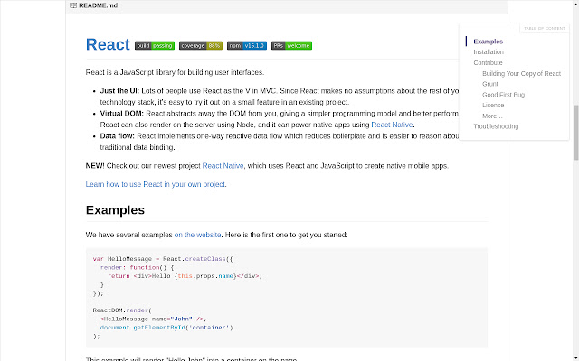

# study-is-wonderful

> 由于课程列表很长，推荐安装谷歌扩展 Smart TOC 来提升阅读体验（会自动在网页右侧边缘生成一个可跳转的目录。
> 
> [Smart TOC](https://chrome.google.com/webstore/detail/smart-toc/lifgeihcfpkmmlfjbailfpfhbahhibba?utm_source=chrome-ntp-icon) 示例如下：

Awesome public courses, welcome to share other wonderful learning resources by issue or PR.

> 本项目主要面向汉语人群，收集了一些比较好的课程资源，一起撸起袖子加油干 。

Resourse is collected from the following platforms, thanks to them.

> 客套话。

 &nbsp &nbsp &nbsp &nbsp &nbsp 

OK, let's start studying 🙌

# Math

## 斯坦福

1. [数学思维课](https://www.bilibili.com/BV1dq4y127TF) 
2. [凸优化](https://www.bilibili.com/BV1Pg4y187Ed) 
3. [傅里叶变换及其应用](https://www.bilibili.com/BV1Qx411J7ER) 
4. [矩阵论与应用](https://www.bilibili.com/BV17h411W7bk) 

## CMU

1. [凸优化](https://www.bilibili.com/BV12x411z7ot) 
2. [最优化进阶与随机方法](https://www.bilibili.com/BV1J64y1F7nW) 
3. [离散微分几何](https://www.bilibili.com/BV1RQ4y1Z7HL) 

## 加州伯克利

1. [最优化方法](https://www.bilibili.com/BV19y4y1W7X1) 
2. [数值分析](https://www.bilibili.com/BV1gv411j7rd) 
3. [随机过程](https://www.bilibili.com/BV1qB4y1A7t3) 

## 牛津

1. [数值方法](https://www.bilibili.com/BV1sT4y1S7Aa) 

## 哈佛

1. [概率论](https://www.bilibili.com/BV1kE41157pa) 
2. [抽象代数](https://www.bilibili.com/BV1Ds41167HE) 

## MIT

1. [概率论](https://www.bilibili.com/BV19s41167TE) 
2. [应用统计](https://www.bilibili.com/BV14t411N7uw) 
3. [离散随机过程](https://www.bilibili.com/BV1Qs41167VS) 
4. [傅里叶分析](https://www.bilibili.com/BV1Qz4y167rb) 
5. [线性代数](https://www.bilibili.com/BV1zx411g7gq) 
6. [线性代数](https://www.bilibili.com/BV1fi4y1x7AH) 
7. [离散数学](https://www.bilibili.com/BV1zh41167Uy) 
8. [复分析](https://www.bilibili.com/BV1EJ41147q3) 
9. [微分方程](https://www.bilibili.com/BV1eM4y1g7De) 
10. [图论与可加组合学](https://www.bilibili.com/BV1Ei4y1x73V) 
11. [黎曼几何](https://www.bilibili.com/BV19T4y1M7W5) 

## 耶鲁
1. [博弈论](https://www.bilibili.com/BV1Kt411h7Ep) 

# Computer Science

## general

1. [CMU·Great Ideas in Theoretical Computer Science](https://www.bilibili.com/BV1Wh411y7V9) 
2. [MIT·The Missing Semester of Your CS Education](https://www.bilibili.com/BV1x7411H7wa) 
3. [哈佛·CS50X 计算机入门](https://www.bilibili.com/BV1ER4y157uA) 
4. [斯坦福·编程方法学](https://www.bilibili.com/BV1zs411h7t8) 
5. [斯坦福·CS101](https://web.stanford.edu/class/cs101/)
6. [MIT·Introduction to Computer Science and Programming in Python](https://ocw.mit.edu/courses/electrical-engineering-and-computer-science/6-0001-introduction-to-computer-science-and-programming-in-python-fall-2016/)

## Algorithms and Data Structures

1. [MIT·经典算法](https://www.bilibili.com/BV1kf4y1w7Kn) 
2. [MIT·算法导论](https://www.bilibili.com/BV1fu41127MN) 
3. [MIT·高级数据结构](https://www.bilibili.com/BV1iE411n7yJ) 
4. [MIT·高级算法](https://www.bilibili.com/BV11E411u73m) 
5. [MIT·数据结构与算法设计](https://www.bilibili.com/BV1sf4y1H7vb) 
6. [伯克利·CS 61B](https://inst.eecs.berkeley.edu/~cs61b/sp20/index.html)
7. [斯坦福·CS106B Programming Abstractions](https://web.stanford.edu/class/cs106b/)
8. [CSE 373 "The Algorithm Design Manual"](https://www3.cs.stonybrook.edu/~skiena/373/videos/)

## System and Architecture

1. [CMU·计算机系统介绍](https://www.bilibili.com/BV1uK4y1e7ep) 
2. [加州伯克利·Operating System and Systems Programming](https://www.bilibili.com/BV1ix411676b) 
3. [MIT·操作系统](https://www.bilibili.com/BV1QA411F7ij) 
4. [MIT·分布式系统](https://www.bilibili.com/BV1CU4y1P7PE) 
5. [MIT·计算机系统安全](https://www.bilibili.com/BV1jt411F7Wh) 
6. [伯克利·CS 61C](https://inst.eecs.berkeley.edu/~cs61c/fa20/)
7. CMU·15-213：[B 站翻译](https://www.bilibili.com/video/BV1iW411d7hd) , [课程网页](http://www.cs.cmu.edu/~213/)
8. [斯坦福·CS 107](http://web.stanford.edu/class/cs107/)
9. [南京大学·操作系统](https://space.bilibili.com/202224425/channel/collectiondetail?sid=192498) 

## Artificial Intelligence (general)

> 单独推荐两个 up 主，[跟李沐学AI](https://space.bilibili.com/1567748478/) 和 [shuhuai008](https://space.bilibili.com/97068901/)，前者是讲深度学习的，后者是讲统计学习的，都非常棒 🎉。

1. [CMU·人工智能 (研究生)](https://www.bilibili.com/BV1pC4y1t7px) 
2. [李宏毅·Deep Learning Theory](https://www.youtube.com/watch?v=KKT2VkTdFyc&list=RDLVKKT2VkTdFyc&start_radio=1&rv=KKT2VkTdFyc&t=5) 
3. [李宏毅·Next Step of Machine Learning](https://www.youtube.com/watch?v=XnyM3-xtxHs&list=PLJV_el3uVTsOK_ZK5L0Iv_EQoL1JefRL4) 
4. [李宏毅·Advanced Topics in Deep Learning](https://www.youtube.com/watch?v=IzHoNwlCGnE&list=PLJV_el3uVTsPMxPbjeX7PicgWbY7F8wW9) 
5. [李宏毅·机器学习-v1](https://www.youtube.com/watch?v=CXgbekl66jc&list=PLJV_el3uVTsPy9oCRY30oBPNLCo89yu49), [李宏毅·机器学习-v2](https://www.youtube.com/watch?v=Ye018rCVvOo&list=PLJV_el3uVTsMhtt7_Y6sgTHGHp1Vb2P2J), [李宏毅·机器学习-v1](https://www.youtube.com/watch?v=7XZR0-4uS5s&list=PLJV_el3uVTsPM2mM-OQzJXziCGJa8nJL8), [李宏毅·机器学习-TA 补充课](https://www.youtube.com/watch?v=eybCCtNKwzA&list=PLJV_el3uVTsM8QoIIe9JrSDjB0e1UkbEC) 
9. [MIT·深度学习](https://www.bilibili.com/BV1qt411c7Na) 
10. [MIT·机器学习](https://www.bilibili.com/BV1a7411M7wH) 
11. [斯坦福·人工智能原理与技术](https://www.bilibili.com/BV1Ht4y1U75j) 
9. [伯克利·CS 188](https://inst.eecs.berkeley.edu//~cs188/fa19/)
10. [伯克利·CS 189](https://www.eecs189.org/)

### Computer Vision (CV)

> 李飞飞的 [cs231n](https://www.bilibili.com/BV1nJ411z7fe) 我看过，感觉不咋地，就没加。

1. [李宏毅·GAN-2018](https://www.youtube.com/watch?v=DQNNMiAP5lw&list=PLJV_el3uVTsMq6JEFPW35BCiOQTsoqwNw), [李宏毅·GAN-2017](https://www.youtube.com/watch?v=G0dZc-8yIjE&list=PLJV_el3uVTsMd2G9ZjcpJn1YfnM9wVOBf) 

### Natural Language Processing (NLP)

1. [CMU·自然语言处理](https://www.bilibili.com/BV1dC4y1h788) 
2. [斯坦福·深度自然语言处理](https://www.bilibili.com/BV1pt411h7aT) 
3. [CMU·高级自然语言处理](https://www.bilibili.com/BV1H3411k7GA) 
4. [李宏毅·Deep Learning for Human Languange Processing](https://www.youtube.com/watch?v=nER51ZyJaCQ&list=PLJV_el3uVTsO07RpBYFsXg-bN5Lu0nhdG) 
5. [李宏毅·Deep Reinforcement Learning](https://www.youtube.com/watch?v=z95ZYgPgXOY&list=PLJV_el3uVTsODxQFgzMzPLa16h6B8kWM_) 

### Reinforcement Learning (RL)

1. [斯坦福·强化学习](https://www.bilibili.com/BV1sb411s7eQ) 
2. [MIT·识别，估计和学习](https://www.bilibili.com/BV1KL4y1e7F7) 
3. [加州伯克利·深度强化学习](https://www.bilibili.com/BV1fx411S7S8) 

### Statistical Learning (SL)

1. [加州伯克利·统计机器学习](https://www.bilibili.com/BV1KA41157yn) 
2. [斯坦福·统计学习](https://www.bilibili.com/BV1NW41177q4) 

### Other Topics 

1. [CMU·结构化数据机器学习](https://www.bilibili.com/BV1MK4y1a7PS) 
2. [加州理工·机器学习与统计推断基础](https://www.bilibili.com/BV1uA411n7oV) 
3. [李宏毅·Structured Learning](https://www.youtube.com/watch?v=5OYu0vxXEv8&list=PLJV_el3uVTsNHQKxv49vpq7NSn-zim18V) 
4. [斯坦福·图机器学习](https://www.bilibili.com/BV1Vg4y1z7Nf) 
5. [斯坦福·机器人学](https://www.bilibili.com/BV16s411q7o7) 
6. [MIT·医疗机器学习](https://www.bilibili.com/BV1oa411c7eD) 

## Data Science

1. [CMU·应用数据科学](https://www.bilibili.com/BV1Pa411F7VP) 
2. [加州伯克利·数据科学原理与技术](https://www.bilibili.com/BV19741117jR) 
3. [加州理工·数据驱动算法设计](https://www.bilibili.com/BV1ip4y1X7uY) 
4. [斯坦福·大数据概论](https://www.bilibili.com/BV1SC4y187x1) 
5. [哈佛·大数据算法](https://www.bilibili.com/BV1v54y1x7dQ) 
6. [斯坦福·CS 246](http://web.stanford.edu/class/cs246/)

## Database

1. [CMU·数据库系统介绍](https://www.bilibili.com/BV1Cp4y1C7dv) 
2. [CMU·数据库系统](https://www.bilibili.com/BV1rN411f7Ef) 
3. [加州伯克利·数据库导论](https://www.bilibili.com/BV1yb4y1n7rb) 

## Parallel Computing

1. [CMU·并行计算结构与编程](https://www.bilibili.com/BV16k4y1z7z9) 
2. [加州伯克利·并行计算应用](https://www.bilibili.com/BV1qV411q7RS) 
3. [加州伯克利·并行程序设计导论](https://www.bilibili.com/BV1QQ4y1o7rn) 

## Software Engineering

1. [康奈尔·软件工程](https://www.bilibili.com/BV1aW411E7yr) 
2. [CMU·智能系统软件工程](https://www.bilibili.com/BV1qA411n7X5) 

## Compiler

1. [斯坦福·编译原理](https://www.bilibili.com/BV1NW41177q4) 
2. [康奈尔·高级编译原理](https://www.bilibili.com/BV1hZ4y1L7X4) 

## Computer Network

1. [CMU·计算机网络](https://www.bilibili.com/BV1wT4y1A7cd) 
2. [斯坦福·计算机网络](https://www.bilibili.com/BV137411Z7LR) 
3. [斯坦福·网络安全](https://www.bilibili.com/BV1yA411s7Tp) 

## Computer Graphics

1. [CMU·计算机图形学](https://www.bilibili.com/BV1QZ4y1K7ga) 
2. [闫令琪·现代计算机图形学入门](https://www.bilibili.com/BV1X7411F744) 
3. [MIT·计算机图形学](https://www.bilibili.com/BV167411g7iK) 

## Others

1. [CMU·人机交互系列讲座](https://www.bilibili.com/BV1Bb411v7YH) 
2. [普林斯顿·比特币与加密技术](https://www.bilibili.com/BV1FL411K7vK) 
3. [斯坦福·密码学](https://www.bilibili.com/BV1Ht411w7Re) 
4. [斯坦福·C++ 中的抽象编程](https://www.bilibili.com/BV1G7411k7jG) 
5. [MIT·计算机程序的构造与解释](https://www.bilibili.com/BV1AA411t7Wk) 
6. [MIT·信号与系统](https://www.bilibili.com/BV1L4411H7w3) 
7. [奥本海姆·MIT·信号与系统](https://www.bilibili.com/BV1CZ4y1j7hs) 
8. [MIT·计算结构](https://www.bilibili.com/BV197411s736) 
9. [MIT·python 编程](https://www.bilibili.com/BV1mq4y1u7NB) 
10. [MIT·区块链与金钱](https://www.bilibili.com/BV1pK4y1r7Jf) 

# Economics

1. [耶鲁·金融市场](https://www.bilibili.com/BV1ab411b7jq) 
2. [MIT·微观经济学](https://www.bilibili.com/BV1MV411U75D) 
3. [MIT·金融理论](https://www.bilibili.com/BV1Ft4112796) 
4. [MIT·行为经济学](https://www.bilibili.com/BV11U4y1g78u) 

# Physics

1. [斯坦福·量子力学](https://www.bilibili.com/BV1w4411s7da) 
2. [斯坦福·广义相对论](https://www.bilibili.com/BV1tE411R75K) 
3. [斯坦福·弦理论和 M 理论](https://www.bilibili.com/BV1CE411Q7Cc) 

# Psychology

1. [加州伯克利·心理统计学](https://www.bilibili.com/BV1UJ411c7d8) 
2. [加州伯克利·社会认知心理学](https://www.bilibili.com/BV1Hx411u7SK) 
3. [耶鲁·心理学导论](https://www.bilibili.com/BV1Ps411Z7h1) 
4. [哈佛·积极心理学](https://www.bilibili.com/BV1ga41127Zt) 
5. [哈佛·心理学导论](https://www.bilibili.com/BV1hZ4y1w7kd) 
6. [哈佛·幸福课](https://www.bilibili.com/BV1px411d7xr) 

# Metaphysics

1. [耶鲁·现代社会理论基础](https://www.bilibili.com/BV1ux411r736) 
2. [耶鲁·资本主义](https://www.bilibili.com/BV1x5411g7R5) 
3. [耶鲁·政治哲学导论](https://www.bilibili.com/BV1wx411y7uW) 
4. [斯坦福·人类行为生物学](https://www.bilibili.com/BV1FF411Y72Y) 
5. [剑桥·美学](https://www.bilibili.com/BV1av411e778) 

# Others

1. [MIT·几何折叠算法](https://www.bilibili.com/BV14q4y1R7Ra) 
2. [斯坦福·如何创业](https://www.bilibili.com/BV1KK4y1s7mY) 
3. [斯坦福·SCI 论文写作课程](https://www.bilibili.com/BV1zv41177JQ) 
4. [欧丽娟说红楼梦](https://www.bilibili.com/BV1hp4y1t7zq) 
5. [罗翔讲刑法](https://www.bilibili.com/BV1dj411f7vb) 
6. [耶鲁·聆听音乐](https://www.bilibili.com/BV1sW411a7nM) 
7. [耶鲁·文学理论导论](https://www.bilibili.com/BV15s411x7LU) 
8. [耶鲁·如何管理情绪](https://www.bilibili.com/BV1KK4y1P7Df) 
9. [耶鲁·谈判概论](https://www.bilibili.com/BV13T4y1L7AT) 

